# EDU Education Hotel Admin Panel User Guide

This guide is for the people who manage the EDU Education Hotel reservation system. It explains, step by step, how to sign in to the admin panel, approve reservation requests, verify payments, assign rooms and change hotel settings.

The screenshots were taken with sample data and show the Turkish interface. You can switch the panel to English with the **EN** / **TR** buttons at the top of the screen. Button and field names in this guide refer to the English interface. Names, dates and numbers on your screen will differ from the screenshots.

## Contents

1. [Signing in and out](#1-signing-in-and-out)
2. [Getting to know the screen](#2-getting-to-know-the-screen)
3. [The life of a reservation](#3-the-life-of-a-reservation)
4. [Dashboard](#4-dashboard)
5. [Reservations](#5-reservations)
6. [New Reservation](#6-new-reservation)
7. [Calendar](#7-calendar)
8. [Rooms](#8-rooms)
9. [Guests](#9-guests)
10. [Payments](#10-payments)
11. [Blacklist](#11-blacklist)
12. [Reports](#12-reports)
13. [Settings](#13-settings)
14. [Profile and session](#14-profile-and-session)
15. [Frequently asked questions](#15-frequently-asked-questions)
16. [Appendix: Automatic emails sent to guests](#16-appendix-automatic-emails-sent-to-guests)

---

## 1. Signing in and out

### Signing in

1. Open the admin panel sign-in address in your browser. The system administrator will give you this address. It ends with `/admin-login`.
2. Fill in **Username** and **Password**.
3. Click **Sign in to Admin**.
4. The panel opens after the "Access Granted" message.

Good to know:

- The admin sign-in page is different from the page guests use to sign in with their email. If you type your username on the guest sign-in page, you will see a "please enter a valid email address" warning.
- To change your username or password, contact the system administrator. These cannot be changed from the panel.
- After 5 failed attempts in a row, sign-in is locked for 30 seconds. You can try again when the countdown ends.

### Session length

- Your session stays open for 8 hours. After that you need to sign in again.
- The session is valid only in the browser tab you signed in from. Closing the tab or the browser ends the session.

### Signing out

Click the **Admin** area in the top right corner and choose **Log out**. Always sign out when you finish working on a shared computer.

---

## 2. Getting to know the screen

The panel has three parts:

**Side menu.** Used to move between pages. The menu has three groups:

| Group | Pages |
|---|---|
| Main | Dashboard, Reservations, New Reservation, Calendar |
| Management | Rooms, Guests, Payments, Blacklist |
| System | Reports, Admin Users, Settings |

**Top bar.** On the left you see the name of the current page. On the right are the language switch (**EN** / **TR**) and your account menu. The language switch changes only your own screen. It does not affect guests.

**Content area.** The selected page is shown here.

### Collapsing the menu

To make more room on the screen, click **Collapse** at the bottom of the side menu. The menu turns into a narrow strip of icons. Hover over an icon to see the page name. To expand the menu again, click the arrow at the bottom.

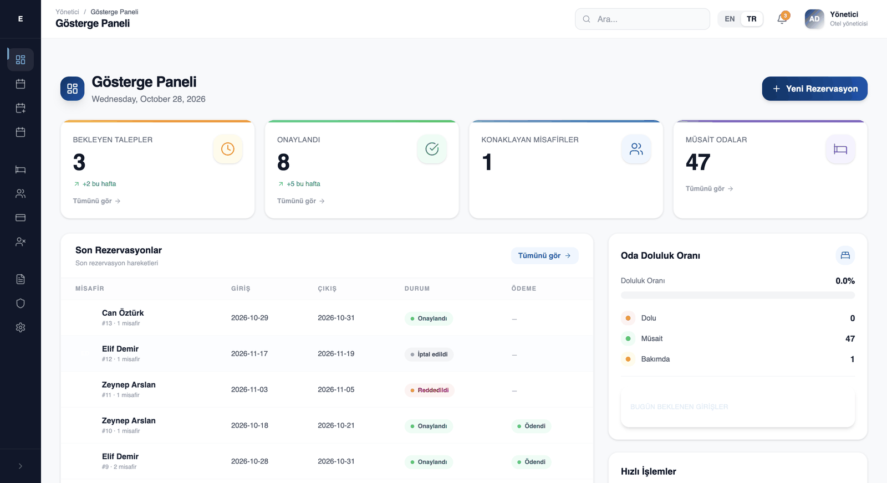

The panel also works on phones and tablets. On small screens, open the menu with the three-line icon in the top left.

---

## 3. The life of a reservation

Most of the work in the panel is one step of the process below. Understanding this section first will make the rest of the guide easier.

| Step | Who | What happens | Email to guest? |
|---|---|---|---|
| 1. Request | Guest | The guest creates a reservation request on the website. The request is **Pending**. | Yes, "request received" |
| 2. Approve or reject | You | You **approve** the request by setting a price, or **reject** it. | Yes, approval with price, or rejection |
| 3. Payment | Guest | The guest makes a bank transfer and uploads the receipt. The payment becomes **Pending Verification**. | Yes, "receipt received" |
| 4. Payment check | You | You check the receipt and **approve** or **reject** it. If rejected, the guest uploads a new receipt. | Yes, "booking confirmed" or "receipt not accepted" |
| 5. Room assignment | You | You assign one or more rooms to the reservation. | Yes, with the room details |

A reservation has two separate statuses that are tracked independently:

**Reservation status**

| Status | Meaning |
|---|---|
| Pending | The request is waiting for your approval. |
| Approved | The request is approved. Payment and room assignment may still be in progress. |
| Rejected | You rejected the request. The process has ended. |
| Canceled | The guest canceled the reservation. |

**Payment status**

| Status | Meaning |
|---|---|
| Empty (–) | The guest has not uploaded a receipt yet. |
| Pending / Pending Verification | A receipt was uploaded and is waiting for your check. |
| Paid | You approved the receipt. |
| Rejected | You rejected the receipt. A new one is expected from the guest. |

### Rules guests must follow

The system does not let guests create requests that break the rules below. Knowing them helps when answering guest questions.

- Check-in on Sunday is not allowed.
- Saturday check-in together with Sunday check-out is not allowed.
- Personal stays can be at most 5 nights.
- Requests can be made at most 30 days in advance.
- A program code is required for corporate and education stays.
- A guest can cancel their own reservation if check-in is more than 24 hours away and the payment has not been approved yet.

You can change the night and day limits on the [Settings](#13-settings) page.

---

## 4. Dashboard

This page opens first when you sign in. It gives you an overview of the day.

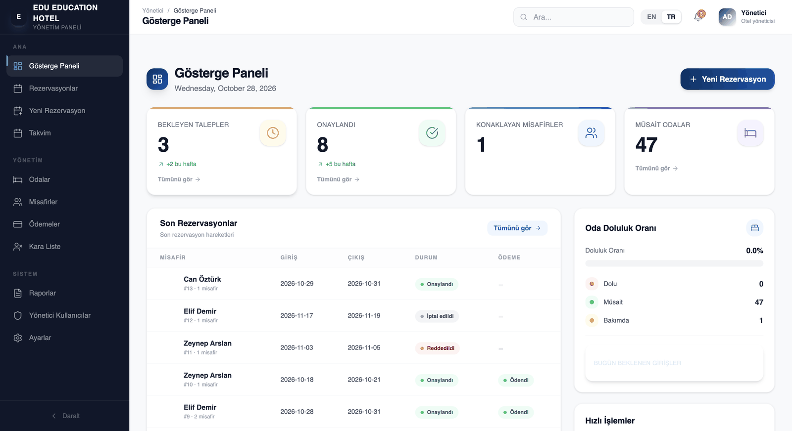

The four cards at the top:

| Card | What it shows |
|---|---|
| Pending Requests | Number of requests waiting for your approval |
| Approved | Number of approved reservations |
| Guests Staying | Number of guests staying at the hotel today (people, not reservations) |
| Available Rooms | Number of rooms that are not under maintenance or reserved for special guests |

**View all** on a card takes you to the related page.

The **Recent Reservations** list shows the most recently created reservations with their check-in and check-out dates, reservation status and payment status. Click **View all** to open the full list.

The **New Reservation** button in the top right takes you straight to the [reservation form](#6-new-reservation).

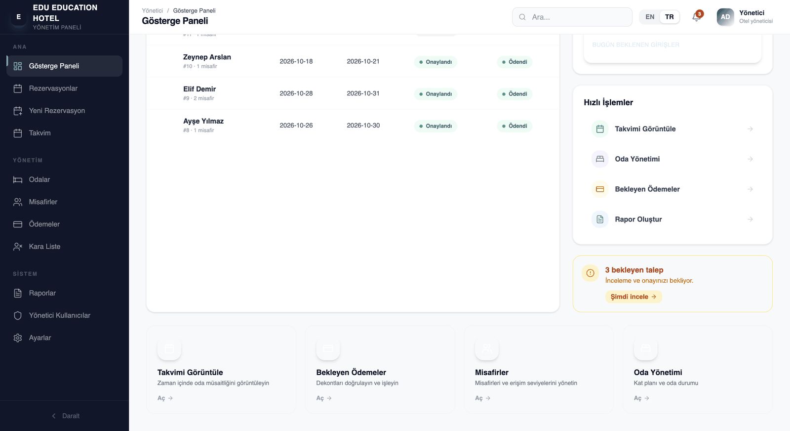

At the bottom of the page:

- **Quick Actions:** shortcuts to the Calendar, Rooms, Pending Payments and Reports pages.
- **Pending request alert:** if requests are waiting for approval, a yellow box shows how many. Click **Review now** to open them.

Suggested order when starting the day: first check pending requests, then check the receipts on the [Payments](#10-payments) page.

To see which rooms are occupied on a given day, use the [Rooms](#8-rooms) page.

---

## 5. Reservations

Lists all reservations. Approving, rejecting and assigning rooms is done from this page.

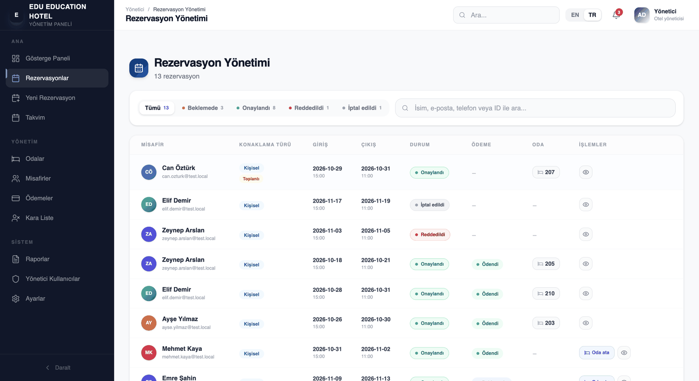

Each row shows the guest's name and email, accommodation type (Personal, Corporate, Education), check-in and check-out dates and times, reservation status, payment status, assigned room and action buttons.

### 5.1 Filtering the list

Use the tabs above the list to filter by status: **All**, **Pending**, **Approved**, **Rejected**, **Canceled**. Each tab shows the number of reservations in that status.

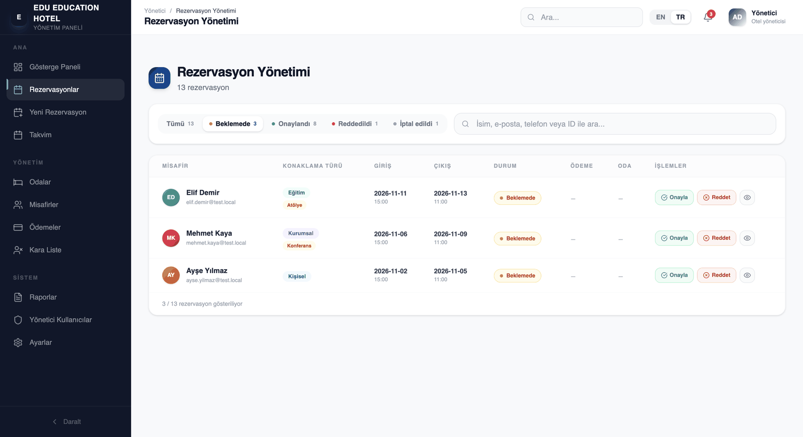

### 5.2 Searching

Type the guest's name, email, phone number or the reservation number into the search box. The list updates as you type. Click the cross at the right of the box to clear the search.

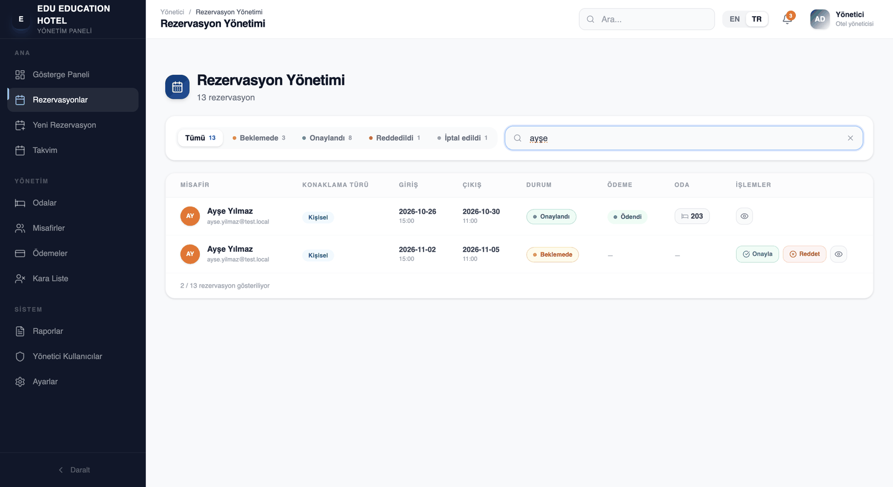

### 5.3 Viewing reservation details

Click the eye icon at the far right of a row. The window that opens contains all reservation details:

- **Guest Information:** name, email, phone, number of guests
- **Stay Details:** dates, check-in and check-out times, assigned room, accommodation and invoice type
- **Billing and Event:** event type, program code, national ID or tax number, free accommodation
- **Additional guests, guest note and admin note** (if any)
- **Identity Documents:** identity documents uploaded by the guest. Click a document's name to open it.

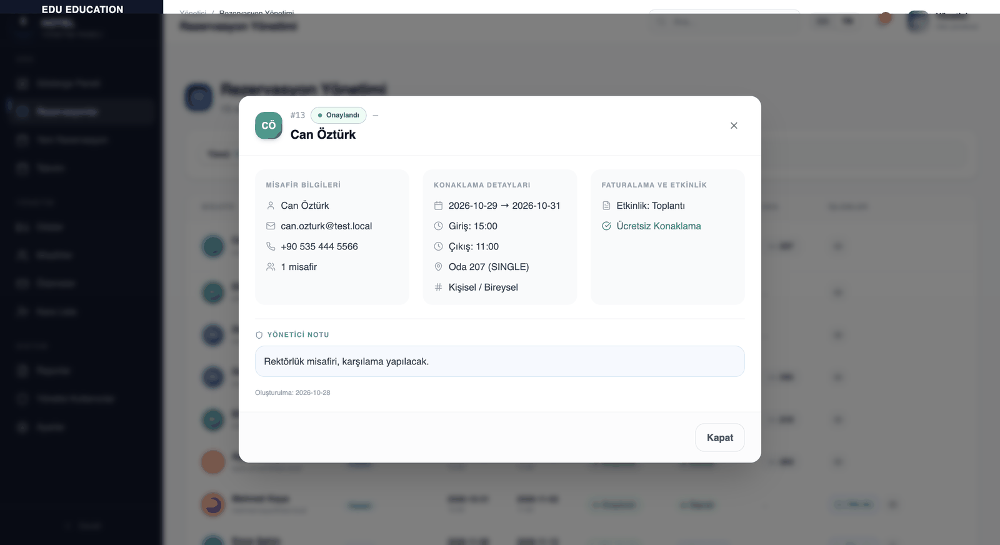

For a pending reservation, the details window also has **Approve** and **Reject** buttons. Click **Close** to close the window.

### 5.4 Approving a request

1. In the row of a pending reservation, click **Approve**.
2. Enter the total price of the stay in **Price (TL)**. This field is required and must be greater than 0.
3. Optionally, write a message for the guest in **Admin note** (up to 500 characters).
4. Click **Approve Reservation**.

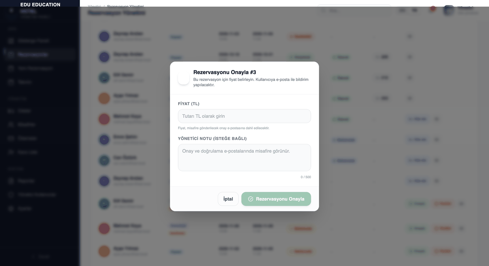

After approval, the guest receives an email with the price and your note, asking them to make the payment and upload the receipt. The bank details shown to the guest are the ones you enter on the [Settings](#13-settings) page.

Requests with a Sunday check-in, or a Saturday check-in with a Sunday check-out, cannot be approved. In that case a warning appears on the screen.

### 5.5 Rejecting a request

1. In the row of a pending reservation, click **Reject**.
2. Type the reason in the box that opens. The reason is optional but recommended, so the guest understands the decision.
3. Click **OK**. Click **Cancel** to go back without rejecting.

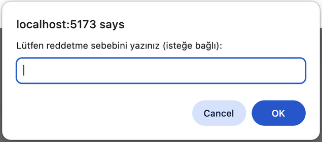

The guest receives an email with the reason. A rejected request cannot be approved later. The guest needs to create a new request.

### 5.6 Assigning a room

**Assign room** appears on reservations that are approved and do not have a room yet.

1. Click **Assign room**.
2. Tick the room or rooms in the list. The top of the window shows how many rooms you selected and their total capacity.
3. Optionally, write an **Admin note**. It is sent to the guest with the room assignment email.
4. Click **Assign Selected**.

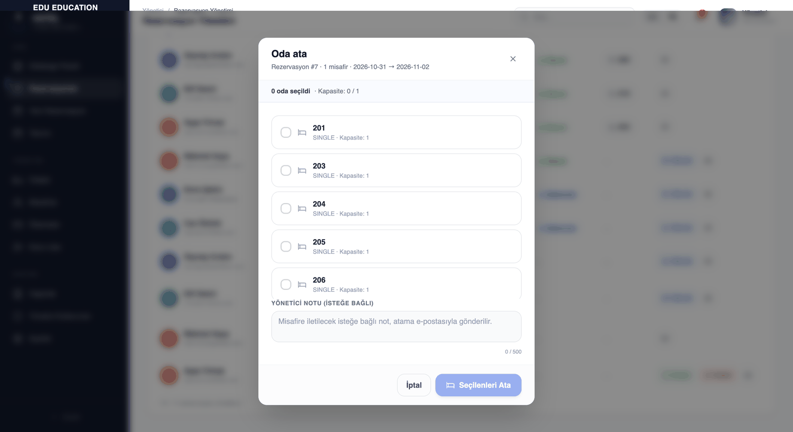

Things to keep in mind:

- Rooms under maintenance are not listed.
- You cannot select more rooms than the number of guests. If guests will share a room, you can select fewer rooms.
- If a selected room is already assigned to another reservation on the same dates, the assignment is not made and a warning appears. Choose another room. You can check which rooms are taken on the [Calendar](#7-calendar) page.

It is recommended to assign rooms after the payment is approved. Reservations with an approved payment and no room are also listed on the [Payments](#10-payments) page.

---

## 6. New Reservation

This page lets you enter a reservation directly, without the guest submitting a request on the website. Use it for special guests, institutional visitors or your own stay.

At the top of the page, choose who the reservation is for:

- **For yourself:** you enter your own stay. The form opens with the "Your information" section.
- **For special guest:** you enter a reservation on behalf of a guest. The form opens with the "Guest information" section, where you can also choose the guest type (default: Special guest).

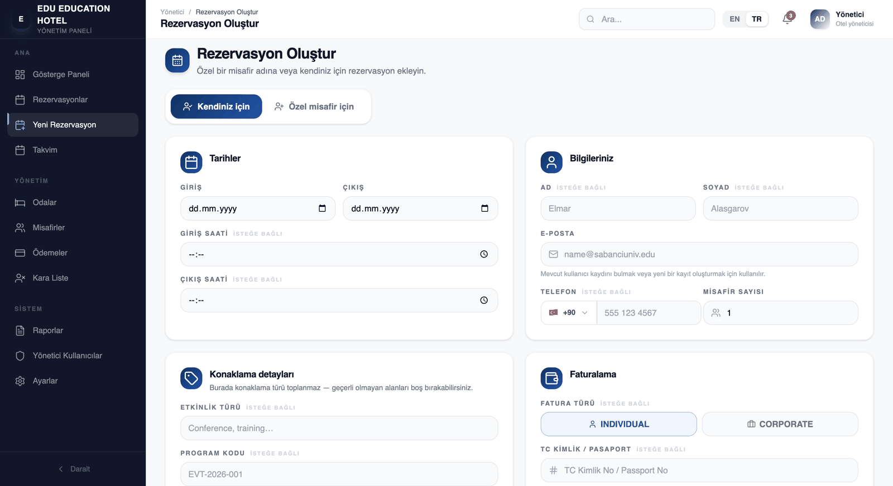

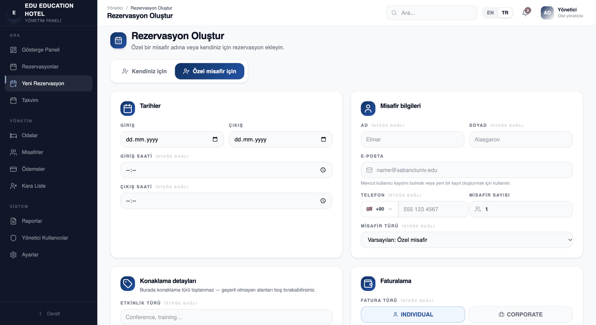

### Filling in the form

Required fields:

- **Check-in** and **Check-out** dates (check-out must be after check-in)
- **Email**
- **Number of guests** (at least 1)

All other fields marked "optional" can be left empty: check-in and check-out times, first name, last name, phone, event type, program code, billing details, price, free accommodation, guest note and admin note.

When you are done, click **Create Reservation** at the bottom of the page.

### Good to know

- **The email address matters:** if the email belongs to a registered user, the reservation is added to that user's account. If not, a new guest record is created with this email.
- **Status:** reservations created here start as **Approved**. You do not need to approve them separately.
- **Rules are not applied:** the rules that apply to guests (Sunday check-in, night limit, 30-day limit) do not apply here.
- **No email is sent:** the guest does not receive an email when you create a reservation here. Inform the guest yourself.
- **Room assignment:** you do not choose a room on this page. After creating the reservation, assign a room with **Assign room** on the [Reservations](#56-assigning-a-room) page.

---

## 7. Calendar

Shows on which days of the month each room is occupied.

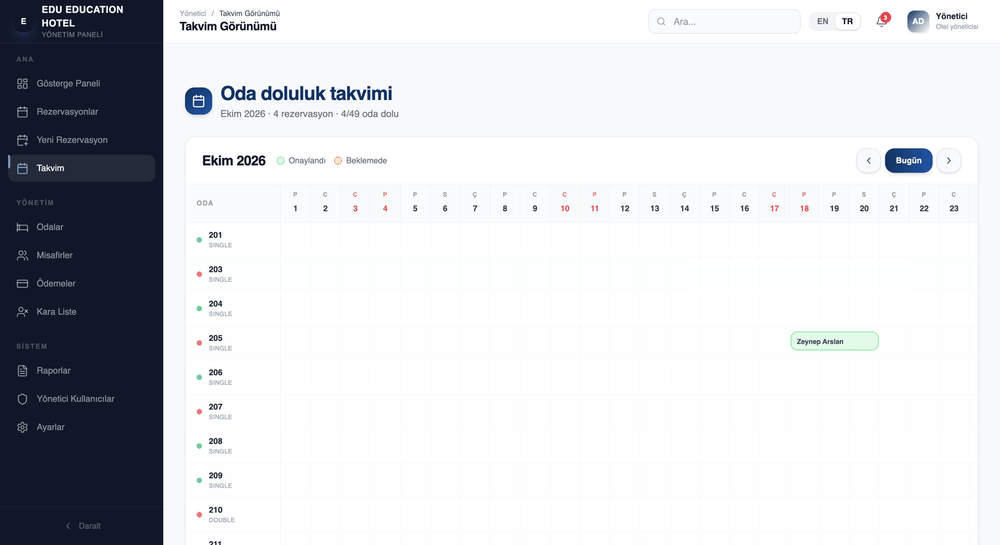

- Each row is a room and each column is a day of the month. Weekends are shown in red.
- Occupied days are shown as a colored bar with the guest's name. Green bars are approved reservations, yellow bars are pending ones.
- Below the title you see how many reservations the month has and how many rooms are occupied.
- Use the arrow buttons in the top right to move between months, and **Today** to return to the current month.

Only reservations with an assigned room appear on the calendar. You can find reservations without a room on the [Reservations](#5-reservations) or [Payments](#10-payments) page.

---

## 8. Rooms

Shows the status of the 49 rooms on the 2nd floor and lets you change room statuses. 47 rooms are single rooms. Rooms 210 and 242 are double rooms.

### 8.1 Floor plan and cards

The page has two views. Switch between them with **Floor Plan** and **Cards** in the top right.

**Floor Plan** shows the rooms in their real layout on the floor:

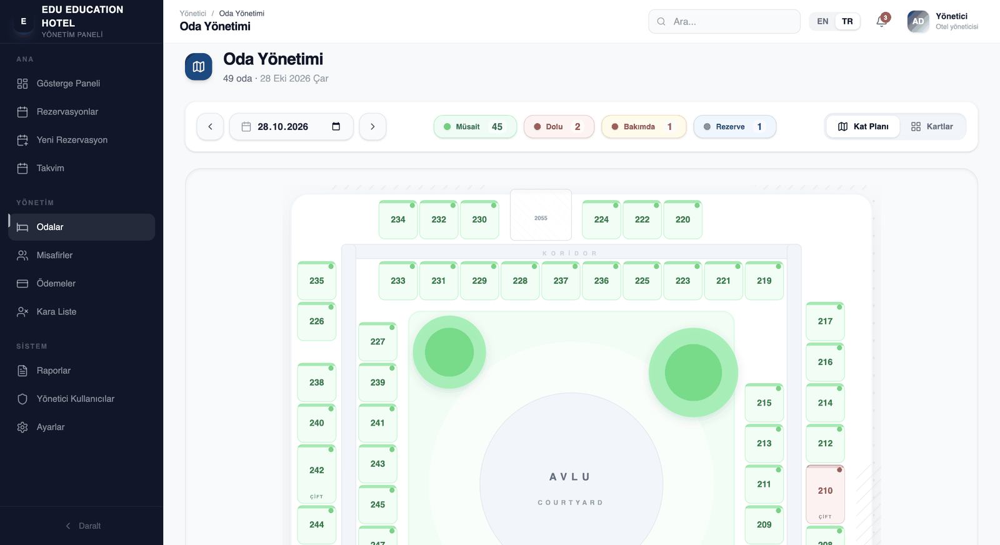

**Cards** lists the rooms by number. Occupied room cards show the guest's name and reservation number:

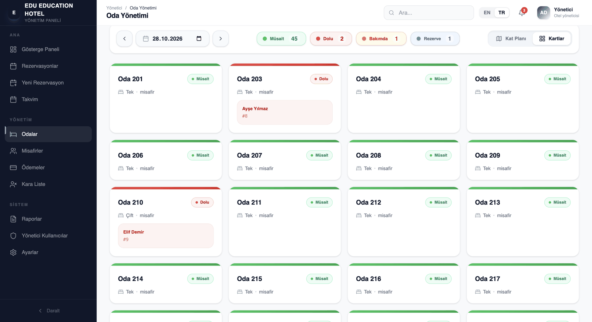

Rooms are color coded:

| Color | Status | Meaning |
|---|---|---|
| Green | Available | The room is free and can be booked. |
| Red | Occupied | A guest is staying in the room on the selected date. |
| Yellow | Maintenance | The room is out of use. It is not listed when assigning rooms. |
| Blue | Reserved | The room is set aside for special guests and cannot be booked through the system. |

The top of the page shows how many rooms are in each status. Use the date box or the arrows next to it to look at another day.

### 8.2 Viewing room details

Click a room. Its type, capacity and amenities open on the right. If the room is occupied, the guest's name, reservation number and stay dates are also shown.

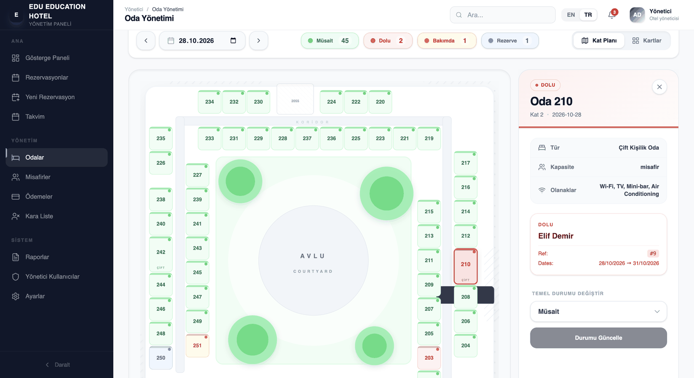

### 8.3 Changing a room's status

To put a room under maintenance or set it aside for special guests:

1. Click the room.
2. Choose the new status under **Change Base Status**: **Available**, **Maintenance** or **Reserved (Special Guests)**.
3. Click **Update Status**.

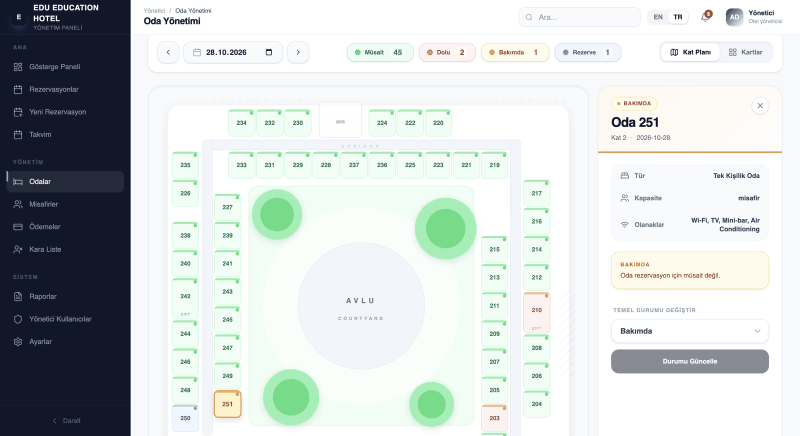

"Occupied" is not set by hand. The system sets it based on the dates of the reservations assigned to the room.

When maintenance or special use ends, remember to set the room back to **Available**. Otherwise the room will not appear in the room assignment list.

---

## 9. Guests

Shows all registered users.

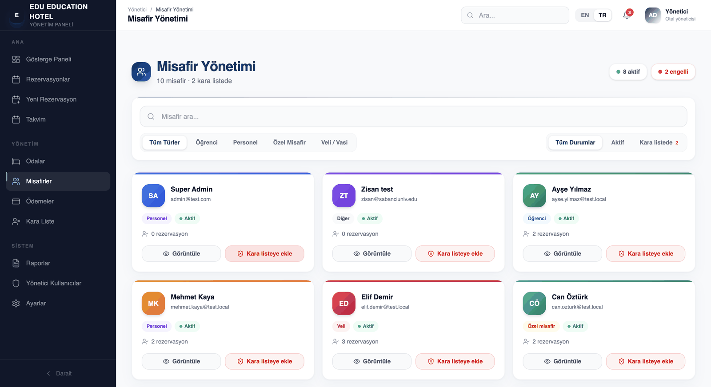

Each guest card shows the guest's name, email, guest type (Student, Staff, Special Guest, Parent, Other), status (Active or Blacklisted) and total number of reservations. The top right of the page shows the number of active and blocked guests.

### 9.1 Searching and filtering

- Type the guest's name or email into the search box.
- Use the buttons on the left to filter by guest type: **All Types**, **Student**, **Staff**, **Special Guest**, **Parent / Guardian**.
- Use the buttons on the right to filter by status: **All Statuses**, **Active**, **Blacklisted**.

Cards of blacklisted guests also show the reason they were blacklisted:

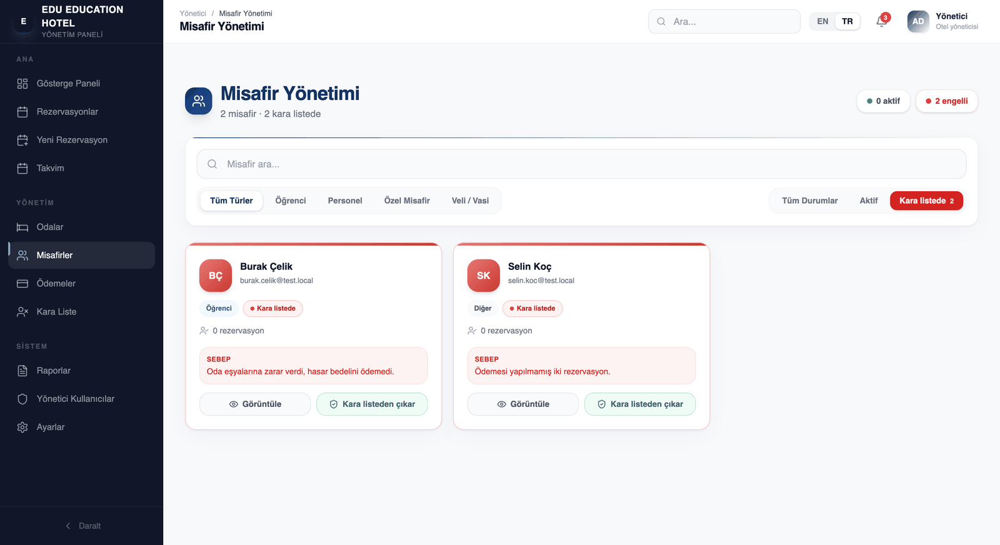

### 9.2 Guest details

Click **View** on a guest card. The window that opens shows the guest's reservation history.

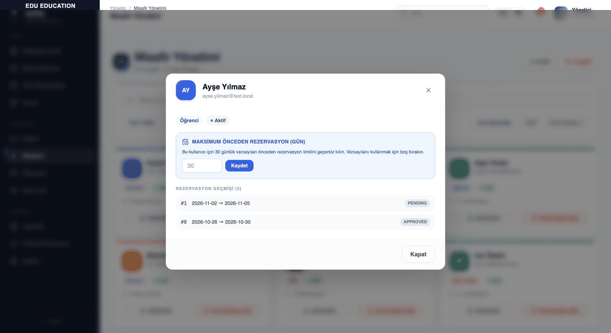

### 9.3 A custom advance booking limit for one guest

Guests can normally create requests up to 30 days in advance. If a specific guest needs to book further ahead:

1. Open the guest's details window.
2. Enter the number of days in **Max Advance Booking (days)**.
3. Click **Save**.

To return to the general limit, clear the field and click **Save**.

### 9.4 Adding a guest to or removing a guest from the blacklist

Click **Add to blacklist** on the guest card, type the reason in the box that opens and confirm. On a blacklisted guest's card, this button is replaced by **Remove from blacklist**.

To add a temporary block or manage all blocked users in one place, use the [Blacklist](#11-blacklist) page.

---

## 10. Payments

This is where you check the receipts uploaded by guests and assign rooms to reservations with approved payments.

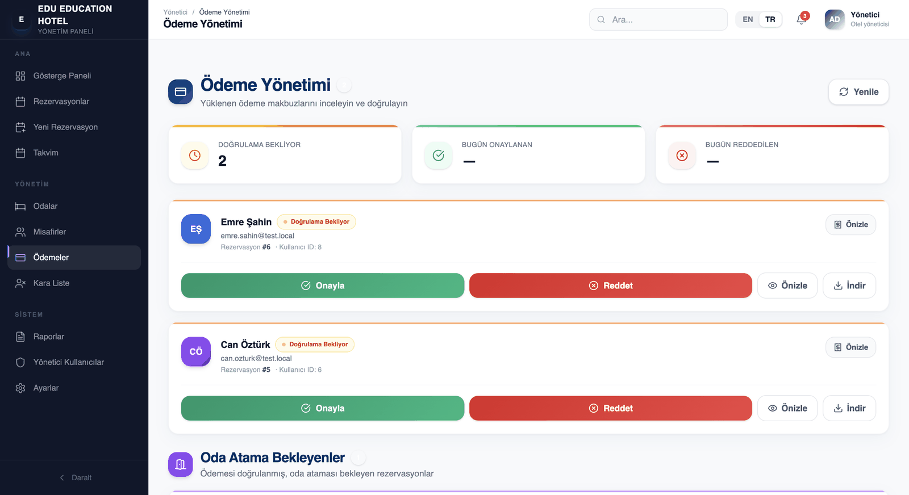

The cards at the top show the number of receipts waiting for verification and how many were approved and rejected today. Click **Refresh** in the top right to update the list.

### 10.1 Checking a receipt

Each receipt card shows the guest's name, email and reservation number.

- **Preview:** opens the receipt in a window without leaving the page.
- **Download:** saves the receipt to your computer.

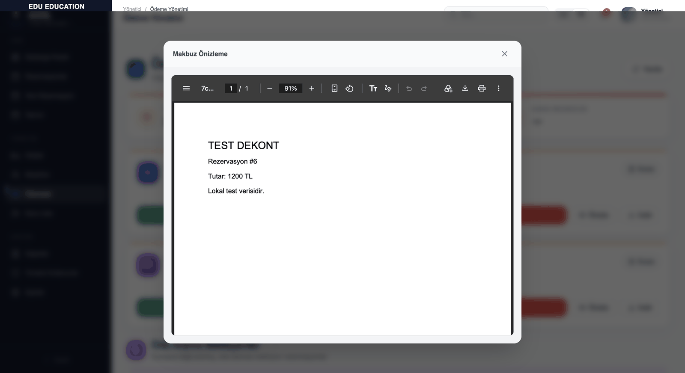

Before approving a receipt, compare it with your bank account transactions:

- Does the amount paid match the price you set when approving the reservation?
- Was the payment made to the correct account (IBAN)?
- Do the sender name and description match the guest and the reservation number?

To see the price of a reservation, open its details on the [Reservations](#53-viewing-reservation-details) page.

### 10.2 Approving a payment

1. Click **Approve** on the receipt card.
2. When asked to confirm, click **OK**.

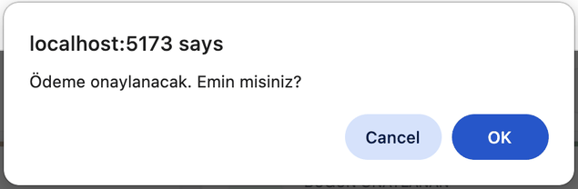

The payment is marked **Paid** and the guest receives a "booking confirmed" email, which also includes the key card pickup instructions. The reservation moves to the **Pending Room Assignment** list below.

### 10.3 Rejecting a payment

1. Click **Reject** on the receipt card.
2. Type a reason in the box that opens, for example "Amount is missing" or "Receipt is not readable". The reason is optional.
3. Click **OK**.

The guest receives an email with the reason, asking them to upload a new receipt. When the guest uploads a new receipt, it appears in this list again.

### 10.4 Pending room assignment

The lower part of the page lists reservations whose payment is approved but which do not have a room yet. Each row shows the guest's name, reservation number, dates and number of guests.

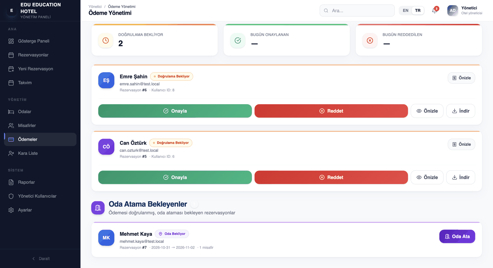

Click **Assign Room** and follow the steps in [Assigning a room](#56-assigning-a-room). When the list is empty, every paid reservation has a room.

---

## 11. Blacklist

Blacklisted users cannot sign in to the system and cannot create reservation requests.

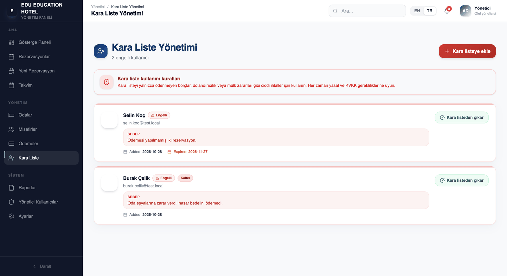

Use the blacklist only for serious cases such as unpaid debts, fraud or damage to the hotel. Write a factual reason without personal data, and follow data protection (KVKK) requirements.

The list shows each user's name, email, reason, date added and, for temporary blocks, the end date. Permanent blocks are marked "Permanent".

### 11.1 Adding to the blacklist

1. Click **Add to blacklist** in the top right.
2. Type the user's ID, email or name in the search box and select the user from the results.
3. Choose the **Block type**:
   - **Permanent block:** no end date.
   - **Temporary (until date):** you will be asked to choose an end date.
4. Fill in **Reason**. This field is required.
5. Click **Block User**.

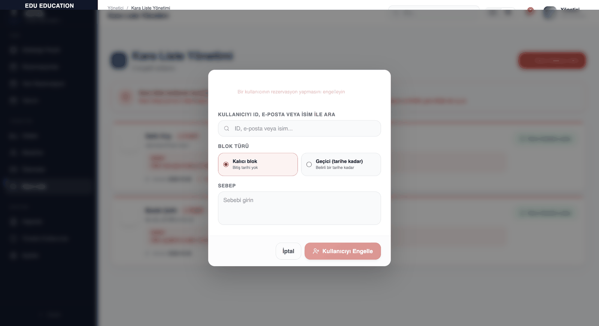

### 11.2 Removing from the blacklist

Click **Remove from blacklist** in the user's row and confirm. The user can sign in and create requests again right away.

**Important:** temporary blocks are not lifted automatically when their end date arrives. Remove users whose end date has passed from this page by hand. You can check end dates in the list.

---

## 12. Reports

Lets you download reservation, occupancy and revenue information as a file.

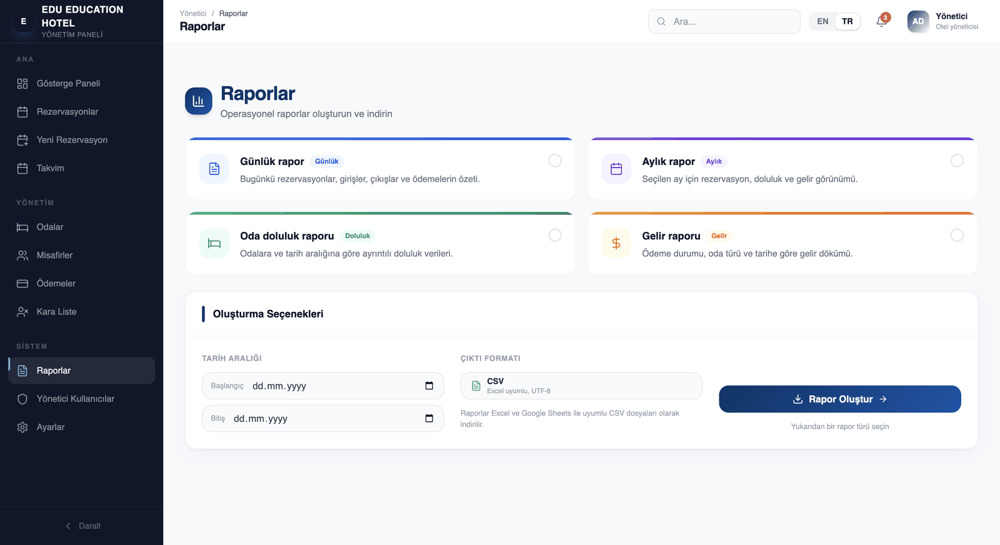

### Report types

| Report | Contents | If you do not choose dates |
|---|---|---|
| Daily report | Check-ins and check-outs on the selected day, guests staying that day, and summary counts | Today |
| Monthly report | All reservations with check-in in the selected range, with status, payment status and price, plus a summary by status | This month |
| Room occupancy report | How many nights each room was occupied in the selected range | Last 30 days |
| Revenue report | Amounts per reservation; total, confirmed and pending verification revenue | Last 30 days |

### Creating a report

1. Click the card of the report type. The circle on the right of the selected card is marked.
2. Optionally, choose **From** and **To** dates under **Date Range**. If you leave them empty, the default range in the table above is used.
3. Click **Generate Report**.

The report is downloaded to your computer as a CSV file. You can open it with Excel, Numbers or Google Sheets. Turkish characters are displayed correctly.

---

## 13. Settings

The hotel's contact details, booking rules, information shown to guests and bank details are managed on this page.

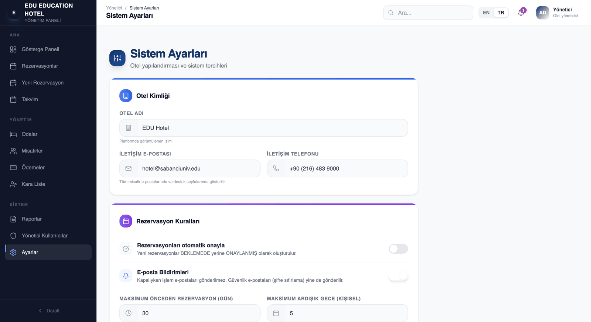

### 13.1 Hotel Identity

| Field | Where it is used |
|---|---|
| Hotel name | The name shown on the platform |
| Contact e-mail | In emails to guests and on support pages |
| Contact phone | On guest pages |

### 13.2 Booking Rules

| Setting | What it does |
|---|---|
| Auto-approve reservations | When on, new requests are created as **Approved** without waiting for you. |
| Email Notifications | When off, transactional emails to guests (approval, rejection, payment, room assignment) are not sent. Password reset emails are always sent. |
| Max advance booking (days) | How far ahead guests can create requests. Default: 30. |
| Max consecutive nights (personal) | The maximum number of nights for personal stays. Default: 5. |

When auto-approve is on, requests are approved without a price, and the price you would enter in the approval window is skipped. Agree on how pricing will be handled before turning this setting on.

### 13.3 Guest-facing Info and Wi-Fi

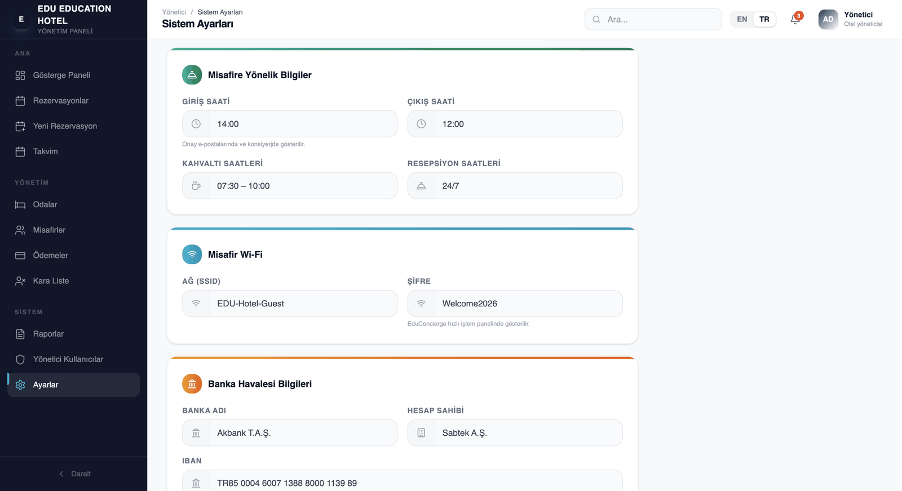

- **Check-in time, Check-out time:** shown in approval emails and on the guest dashboard.
- **Breakfast hours, Reception hours:** shown on the guest dashboard.
- **Guest Wi-Fi (Network name and Password):** shown in the information area of the guest dashboard.

### 13.4 Bank Transfer Details

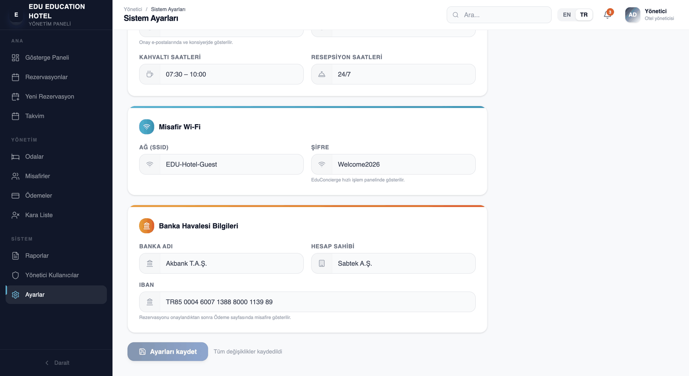

**Bank name**, **Account holder** and **IBAN** are shown to the guest on the payment page after their reservation is approved. Guests send their payment to this account.

**Be very careful when changing the IBAN.** A wrong IBAN means guests send their payment to the wrong account. Check the IBAN twice before saving.

### 13.5 Saving changes

When you make a change, "Unsaved changes" appears at the bottom of the page. Click **Save settings**. When saving is complete, a confirmation message appears and the text changes to "All changes saved".

If you leave the page without saving, your changes are lost. Saved settings appear on guest pages within one minute at the latest.

---

## 14. Profile and session

Click the **Admin** area in the top right and choose **Profile settings** to open your profile page.

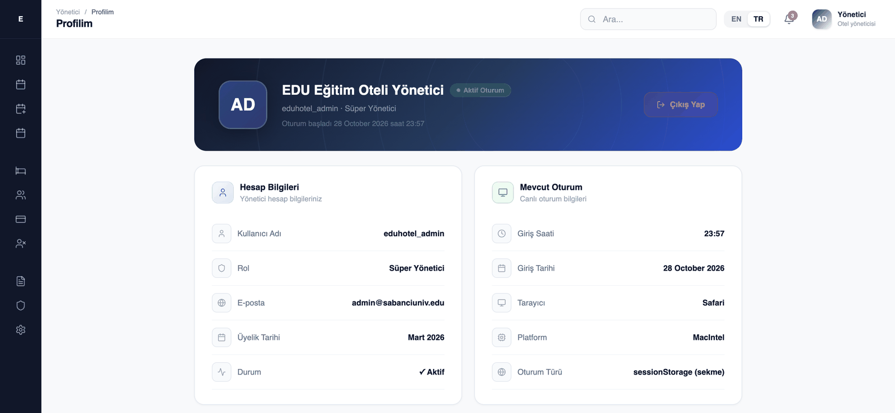

- **Account Information:** your username and role
- **Current Session:** your sign-in time and date, browser and platform

You can also end your session with the **Sign Out** button at the top of the page. To change your password, contact the system administrator.

---

## 15. Frequently asked questions

**I clicked Approve but the request was not approved.**
The request may have a Sunday check-in, or a Saturday check-in with a Sunday check-out. These cannot be approved. Also make sure the price in the approval window is greater than 0.

**I do not see "Assign room" on a reservation.**
Rooms can only be assigned to reservations that are **Approved** and do not have a room yet. If the reservation is pending, approve it first. If it already has a room, the room number is shown in the room column.

**I get an "already booked" warning when assigning a room.**
The room is assigned to another reservation on the same dates. Check free rooms on the [Calendar](#7-calendar) page and choose another room.

**The room I want to assign is not in the list.**
The room may be under **Maintenance**. Set it to **Available** on the [Rooms](#8-rooms) page.

**I get a "file not found" warning when approving a receipt.**
The receipt file cannot be reached. Reject the receipt and ask the guest to upload it again. If the problem repeats, report it to the system administrator.

**A guest says they cannot sign in.**
First check the [Blacklist](#11-blacklist) page. If the guest is not blacklisted, suggest resetting their password with the "Forgot password?" link on the sign-in page.

**I need to cancel an approved reservation.**
The panel does not have an option to cancel an approved reservation. The guest can cancel it from their own account if check-in is more than 24 hours away and the payment has not been approved yet. For other cases, contact the system administrator.

**A guest wants to book more than 30 days in advance.**
You can set a custom limit for that guest. See [A custom advance booking limit for one guest](#93-a-custom-advance-booking-limit-for-one-guest). Alternatively, you can enter the reservation yourself on the [New Reservation](#6-new-reservation) page.

**My session ended suddenly.**
The session ends after 8 hours or when the browser tab is closed. Sign in again.

---

## 16. Appendix: Automatic emails sent to guests

The system sends the emails below automatically, in Turkish or English depending on the guest's language. If **Email Notifications** is off on the [Settings](#13-settings) page, these emails are not sent.

| When | Subject |
|---|---|
| A guest creates a request | EDU Hotel – Reservation request received |
| You approve a request | EDU Hotel – Reservation approved |
| You reject a request | EDU Hotel – Reservation not approved |
| A guest uploads a receipt | EDU Hotel – Payment receipt received |
| You approve a payment | EDU Hotel – Booking confirmed |
| You reject a payment | EDU Hotel – Payment receipt not accepted |
| You assign a room | EDU Hotel – Room assigned |
| A guest cancels a reservation | EDU Hotel – Reservation cancelled |

Each subject ends with the reservation number.

Approval emails include the following key card instructions: for check-ins before 16:30, the room key card is collected from reception against signature. For check-ins after 16:30, the key card is left in a sealed envelope at the main security gate. Guests are asked to show a valid ID at check-in.
