# EDU Eğitim Oteli Misafir Kullanım Kılavuzu

Bu kılavuz, EDU Eğitim Oteli'nde konaklamak isteyen misafirler için hazırlanmıştır. Nasıl hesap açılacağını, rezervasyon talebinin nasıl oluşturulacağını, ödemenin nasıl yapılacağını, rezervasyonun nasıl takip edilip iptal edileceğini ve konaklama sırasında yardıma nasıl ulaşılacağını adım adım anlatır.

Kılavuzdaki ekran görüntüleri örnek verilerle alınmıştır. Sizin ekranınızdaki isimler, tarihler, tutarlar ve banka bilgileri farklı olabilir. Ödeme yaparken her zaman kendi ekranınızda gördüğünüz bilgileri kullanın.

## İçindekiler

1. [Hesap açma, giriş ve çıkış](#1-hesap-açma-giriş-ve-çıkış)
2. [Ekranı tanıyalım](#2-ekranı-tanıyalım)
3. [Bir rezervasyonun yolculuğu](#3-bir-rezervasyonun-yolculuğu)
4. [Ana Sayfa](#4-ana-sayfa)
5. [Oda Rezervasyonu](#5-oda-rezervasyonu)
6. [Rezervasyonlarım](#6-rezervasyonlarım)
7. [Ödeme](#7-ödeme)
8. [Bildirimler](#8-bildirimler)
9. [Atlas Konsiyerj](#9-atlas-konsiyerj)
10. [Profil](#10-profil)
11. [Destek ve iletişim](#11-destek-ve-iletişim)
12. [Otele giriş ve oda kartı](#12-otele-giriş-ve-oda-kartı)
13. [Sık sorulan sorular](#13-sık-sorulan-sorular)
14. [Ek: Size otomatik gelen e-postalar](#14-ek-size-otomatik-gelen-e-postalar)

---

## 1. Hesap açma, giriş ve çıkış

Otelin açılış sayfasındaki **Giriş Yap** veya **Hemen Rezervasyon Yap** düğmeleri sizi giriş sayfasına götürür.

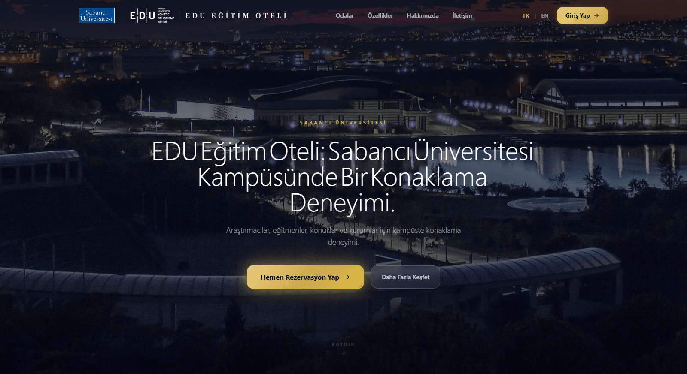

### Hesap açma

1. Giriş sayfasının altındaki **Kayıt olun** bağlantısına tıklayın.
2. **Ad Soyad**, **E-posta Adresi**, **Şifre** ve **Şifreyi Doğrulayın** alanlarını doldurun.
3. KVKK onay kutusunu işaretleyin. Metnin tamamını okumak için **Detayları göster**'e tıklayın.
4. **Hesap oluştur** düğmesine tıklayın.

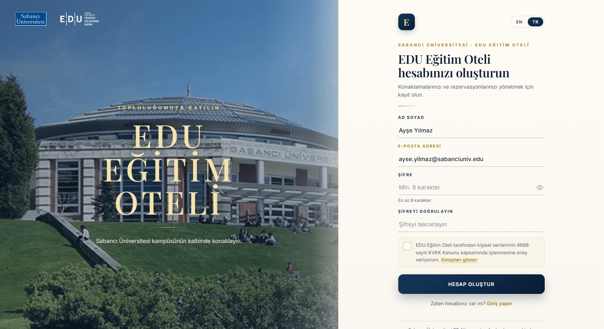

Hesabınız oluşturulunca ayrı bir onay mesajı çıkmaz, doğrudan giriş sayfasına yönlendirilirsiniz. E-posta ve şifrenizle giriş yapabilirsiniz.

Bilmeniz gerekenler:

- Kayıt yalnızca **@sabanciuniv.edu** uzantılı e-posta adresleriyle yapılabilir. Başka bir adresle "Lütfen @sabanciuniv.edu uzantılı e-posta adresinizi kullanın" uyarısı alırsınız. Bu adrese sahip değilseniz rezervasyon için [otelle iletişime geçin](#11-destek-ve-iletişim).
- Şifreniz en az 8 karakter olmalı ve en az bir büyük harf, bir küçük harf, bir rakam ve bir özel karakter içermelidir. Örneğin `Ornek!2026` bu kurala uyar.

### Giriş

1. **E-posta Adresi** ve **Şifre** alanlarını doldurun.
2. **Giriş yap** düğmesine tıklayın.

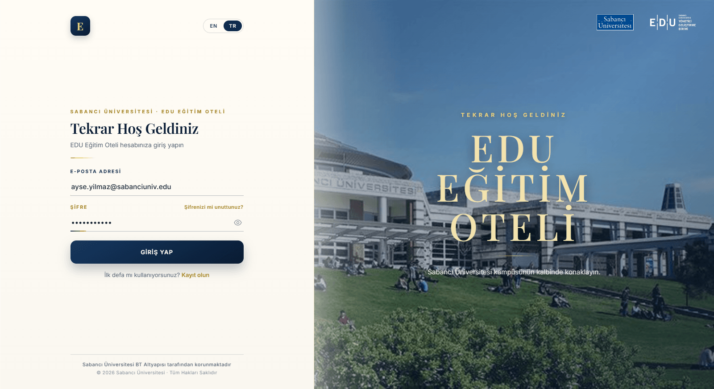

Şifrenizi görmek için alanın sağındaki göz simgesine tıklayabilirsiniz.

Kısa sürede çok fazla deneme yapılırsa (15 dakikada 10 deneme) "Çok fazla deneme yapıldı" uyarısı çıkar ve işlem geçici olarak engellenir. Giriş, kayıt ve şifre yenileme denemeleri bu sayıya birlikte dahildir. Başka kullanıcıların denemeleri de sizi etkileyebilir. Bu uyarıyı görürseniz 15 dakika sonra tekrar deneyin.

### Şifrenizi unuttuysanız

1. Giriş sayfasındaki **Şifrenizi mi unuttunuz?** bağlantısına tıklayın.
2. Kayıtlı e-posta adresinizi yazın ve **Sıfırlama bağlantısı gönder**'e tıklayın.

   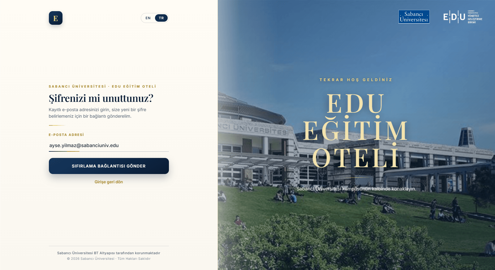

3. Size gelen "EDU Hotel – Şifrenizi sıfırlayın" e-postasındaki düğmeye tıklayın. Bağlantı 1 saat geçerlidir. Yeni bir bağlantı isterseniz yalnızca en sonuncusu çalışır.
4. Yeni şifrenizi iki kez yazın ve **Şifreyi güncelle**'ye tıklayın. Yeni şifre de yukarıdaki şifre kuralına uymalıdır.

   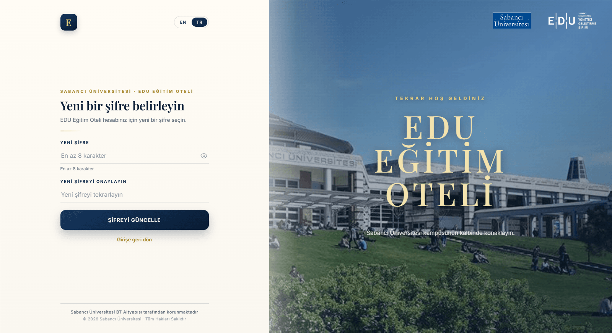

İşlem tamamlanınca kısa bir süre sonra giriş sayfasına yönlendirilirsiniz. E-posta gelmediyse önce gereksiz (spam) klasörünüze bakın.

### Oturum süresi

- Oturumunuz girişten sonra 1 saat geçerlidir. Süre dolunca yeniden giriş yapmanız gerekir.
- Süre dolduğunda sistem sizi giriş sayfasına kendiliğinden götürmez. Sayfalar boş görünürse rezervasyonlarınız silinmemiştir, çıkış yapıp tekrar giriş yapın. Örneğin **Rezervasyonlarım**'da "Henüz rezervasyon yok", Ana Sayfa'daki kartlarda 0, **Ödeme** sayfasında "Aktif rezervasyon bulunamadı" yazabilir.
- Sekmeyi veya tarayıcıyı kapatmak oturumu hemen kapatmaz. Bu yüzden ortak bilgisayarlarda mutlaka çıkış yapın.

### Çıkış

Sağ üst köşedeki adınıza tıklayarak [Profil](#10-profil) sayfasını açın ve **Çıkış Yap** düğmesine tıklayın. Açılış sayfasına dönersiniz.

---

## 2. Ekranı tanıyalım

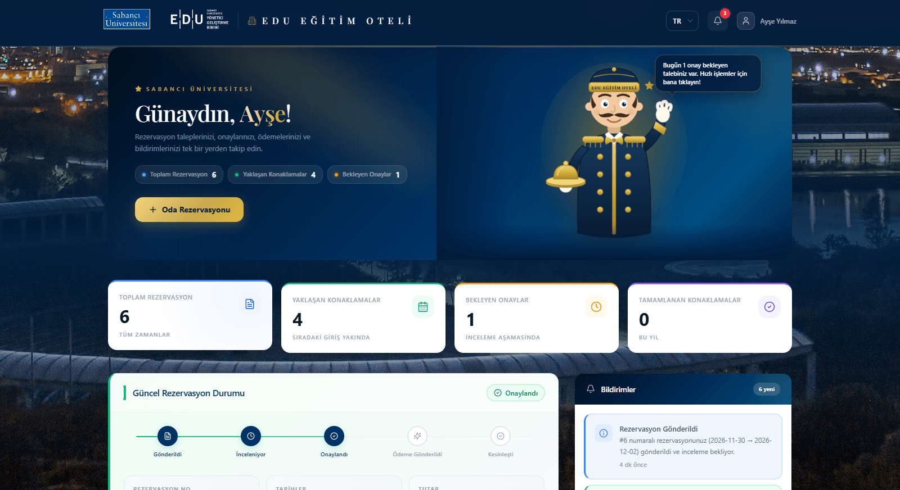

Sayfaların çoğu üç bölümden oluşur:

**Üst çubuk.** Her sayfada görünür. Soldaki logolara tıklayarak [Ana Sayfa](#4-ana-sayfa)'ya dönersiniz. Sağda dil seçimi (**TR** / **EN**), bildirim zili ve adınız bulunur. Adınıza tıklayınca [Profil](#10-profil) sayfası açılır.

**İçerik alanı.** Bulunduğunuz sayfanın içeriği burada görünür.

**Alt bilgi.** Sayfanın en altında sık kullanılan sayfalara bağlantılar ve otelin iletişim bilgileri bulunur.

Misafirlerin kullandığı sayfalar şunlardır:

| Sayfa | Ne işe yarar | Nasıl açılır |
|---|---|---|
| Ana Sayfa | Son rezervasyonunuzun durumu, kısayollar, bildirimler | Üst çubuktaki logolar |
| Oda Rezervasyonu | Yeni rezervasyon talebi oluşturma | Ana Sayfa'daki **Oda Rezervasyonu** |
| Rezervasyonlarım | Tüm talepleri görme, ödemeye geçme, iptal etme | **Hızlı İşlemler** bölümündeki **Rezervasyon Taleplerim** |
| Ödeme | Banka bilgilerini görme, dekont yükleme | **Ödemeye Geç** düğmesi |
| Bildirimler | Rezervasyonunuzla ilgili tüm bildirimler | Zil simgesi, ardından **Tüm Bildirimleri Gör** |
| Profil | Hesap bilgileri ve çıkış | Üst çubuktaki adınız |
| Destek İletişim | Otelin iletişim kanalları | **Hızlı İşlemler** bölümündeki **Destekle İletişime Geç** |

### Dil seçimi

Üst çubuktaki **TR** / **EN** seçimi sitenin dilini değiştirir. Seçtiğiniz dil, otelden size gelecek e-postaların dili olarak da kaydedilir.

### Telefon ve tablet

Site telefon ve tabletlerde de açılır. Telefonda sayfa öğeleri alt alta dizilir ve adınız yerine yalnızca kişi simgesi görünür. Profil sekmelerinde de yazı yerine yalnızca simgeler görünür.

[Atlas Konsiyerj](#9-atlas-konsiyerj) telefonda görünmez. Wi-Fi bilgisi, kampüs haritası, sorun bildirme ve geç çıkış talebi için tablet veya bilgisayar kullanın ya da [otelle iletişime geçin](#11-destek-ve-iletişim).

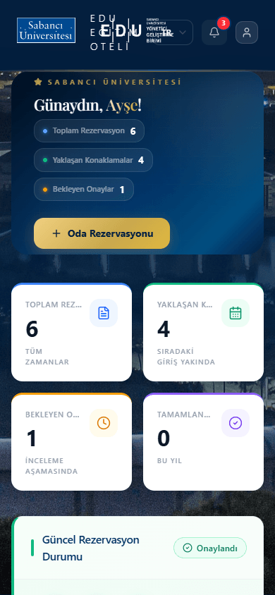

---

## 3. Bir rezervasyonun yolculuğu

Sitedeki işlemlerin çoğu aşağıdaki sürecin bir adımıdır. Rezervasyon anında kesinleşmez. Gönderdiğiniz form bir taleptir ve otel tarafından incelenir. Kılavuzun geri kalanını okumadan önce bu bölümü anlamanız işinizi kolaylaştırır.

| Adım | Kim yapar | Ne olur | Size e-posta gelir mi? |
|---|---|---|---|
| 1. Talep | Siz | Siteden rezervasyon talebi oluşturursunuz. Talep **Beklemede** durumundadır. | Evet, "talebiniz alındı" |
| 2. Onay veya ret | Otel | Otel talebi fiyat belirleyerek **onaylar** ya da **reddeder**. | Evet, fiyatlı onay veya ret bildirimi |
| 3. Ödeme | Siz | Banka havalesi yapar ve dekontu sisteme yüklersiniz. | Evet, "dekontunuz alındı" |
| 4. Ödeme kontrolü | Otel | Otel dekontu kontrol edip **onaylar** ya da **reddeder**. Reddedilirse yeni dekont yüklersiniz. | Evet, "rezervasyonunuz kesinleşti" veya "dekont kabul edilmedi" |
| 5. Oda atama | Otel | Otel rezervasyonunuza oda atar. Oda seçimini misafirler yapamaz. | Evet, oda bilgisiyle |

Rezervasyonun iki ayrı durumu vardır ve ikisi ayrı takip edilir:

**Rezervasyon durumu**

| Durum | Anlamı |
|---|---|
| Beklemede | Talebiniz otelin onayını bekliyor. |
| Onaylandı | Talebiniz onaylandı. Ödeme ve oda süreci devam ediyor olabilir. Konaklamanız ödeme onaylanınca kesinleşir. |
| Reddedildi | Otel talebinizi reddetti. Yeni bir talep oluşturabilirsiniz. |
| İptal Edildi | Rezervasyonunuzu iptal ettiniz. |

**Ödeme durumu**

| Durum | Anlamı |
|---|---|
| Görünmüyor | Henüz dekont yüklemediniz. |
| Ödeme Doğrulanıyor | Dekontunuz yüklendi, otelin kontrolünü bekliyor. Doğrulama genellikle 1 iş günü içinde tamamlanır. |
| Ödeme Onaylandı | Otel dekontunuzu onayladı. Konaklamanız kesinleşti. |
| Ödeme Reddedildi | Otel dekontunuzu kabul etmedi. Yeni bir dekont yüklemeniz gerekir. |

Listelerde **İade Talep Edildi** ve **İade Edildi** durumlarını da görebilirsiniz. İade işlemleri site üzerinden başlatılamaz. İade için [otelle iletişime geçin](#11-destek-ve-iletişim).

### Rezervasyon kuralları

Sistem, aşağıdaki kurallara uymayan talepleri kabul etmez. Otel gece sınırını düşürdüyse uyarıyı formun son adımında görebilirsiniz. Bu durumda uyarıda yazan sınır geçerlidir.

- Pazar günü giriş yapılamaz.
- Cumartesi giriş ve Pazar çıkış birlikte seçilemez.
- Kişisel (bireysel) konaklamalar en fazla 5 gece sürebilir.
- Giriş tarihi en fazla 30 gün sonrası olabilir. Daha ileri bir tarih için otelle iletişime geçin.
- Bir talepte en fazla 10 misafir bulunabilir.
- Kurumsal konaklamalarda program kodu zorunludur.
- Akademik konaklamalarda açıklama yazmak zorunludur.
- Her misafir için kimlik veya pasaport kopyası yüklenmelidir.
- Girişe 24 saatten az kaldıysa veya ödemeniz onaylandıysa rezervasyonunuzu kendiniz iptal edemezsiniz.

---

## 4. Ana Sayfa

Giriş yaptığınızda ilk bu sayfa açılır. En üstte size özel karşılama alanı, özet sayılar ve yeni talep oluşturmak için **Oda Rezervasyonu** düğmesi bulunur. Sağdaki figür, [Atlas Konsiyerj](#9-atlas-konsiyerj) yardımcısını açar.

Karşılama alanının altındaki dört kart:

| Kart | Ne gösterir |
|---|---|
| Toplam Rezervasyon | Şimdiye kadar oluşturduğunuz tüm talepler |
| Yaklaşan Konaklamalar | Giriş tarihi henüz gelmemiş, iptal edilmemiş veya reddedilmemiş talepler |
| Bekleyen Onaylar | Otelin onayını bekleyen talepler |
| Tamamlanan Konaklamalar | Çıkış tarihi geçmiş, onaylanmış rezervasyonlar |

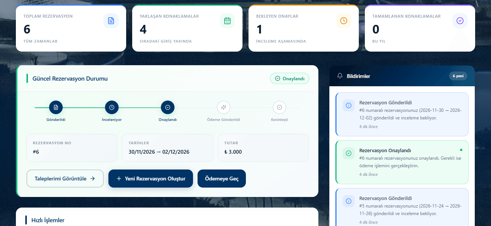

**Güncel Rezervasyon Durumu.** En son oluşturduğunuz rezervasyonu gösterir. Üstteki çizgi hangi aşamada olduğunuzu belirtir: Gönderildi, İnceleniyor, Onaylandı, Ödeme Gönderildi, Kesinleşti. Altında rezervasyon numarası, tarihler ve tutar yazar. Tutar, otel onaylayana kadar "Belirlenecek" olarak görünür.

Bu bölümdeki düğmeler:

- **Taleplerimi Görüntüle:** [Rezervasyonlarım](#6-rezervasyonlarım) sayfasını açar.
- **Yeni Rezervasyon Oluştur:** [Oda Rezervasyonu](#5-oda-rezervasyonu) sayfasını açar.
- **Ödemeye Geç:** Talebiniz onaylanıp fiyatı belirlendiğinde etkinleşir ve [Ödeme](#7-ödeme) sayfasını açar. Talep onaylandığı halde fiyat henüz girilmediyse düğmede **Fiyat Bekleniyor**, dekont yükledikten sonra **Ödeme Gönderildi**, ödeme onaylandıktan sonra **Ödeme Onaylandı** yazar.

**Bildirimler.** Sağdaki bölümde en son üç bildirim görünür. Bir bildirime tıklayınca [Rezervasyonlarım](#6-rezervasyonlarım) sayfası açılır.

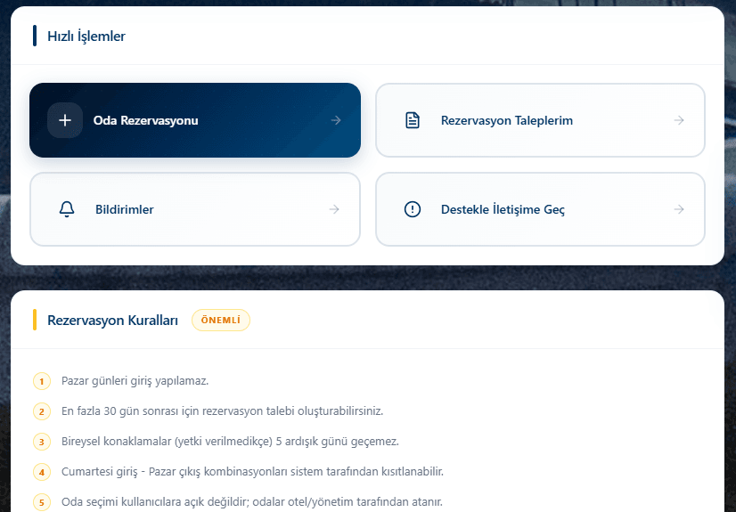

**Hızlı İşlemler.** Oda Rezervasyonu, Rezervasyon Taleplerim, Bildirimler ve Destek İletişim sayfalarına kısayollardır.

**Rezervasyon Kuralları.** [Rezervasyon kurallarının](#rezervasyon-kuralları) kısa özetidir.

Sağ alttaki **Yardıma mı ihtiyacınız var?** kartındaki düğme şu anda bir sayfa açmaz. Destek sayfasına ulaşmak için **Hızlı İşlemler** bölümündeki **Destekle İletişime Geç** kısayolunu kullanın.

---

## 5. Oda Rezervasyonu

Rezervasyon talebi üç adımda oluşturulur. Üstteki çubuk hangi adımda olduğunuzu gösterir. **İleri** ile sonraki adıma, **Geri** ile önceki adıma geçersiniz. Eksik veya kurala uymayan bir bilgi varsa kartın üstünde kırmızı bir uyarı çıkar ve bir sonraki adıma geçilmez.

Formu göndermeden sayfadan çıkarsanız girdiğiniz bilgiler kaybolur.

### 5.1 Adım 1: Konaklama tarihleri

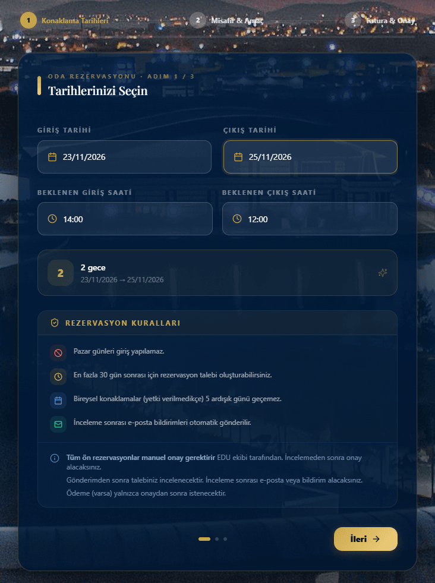

1. **Giriş Tarihi** ve **Çıkış Tarihi** alanlarına tıklayıp takvimden tarih seçin. Geçmiş günler seçilemez.
2. **Beklenen Giriş Saati** ve **Beklenen Çıkış Saati** alanlarını kontrol edin. Otelin standart saatleri hazır gelir. Değiştirmek için alana tıklayın, listeden saat ve dakikayı seçin veya saati yazın.
3. Tarihleri seçince kaç gece kalacağınız kartta görünür. Kontrol edip **İleri**'ye tıklayın.

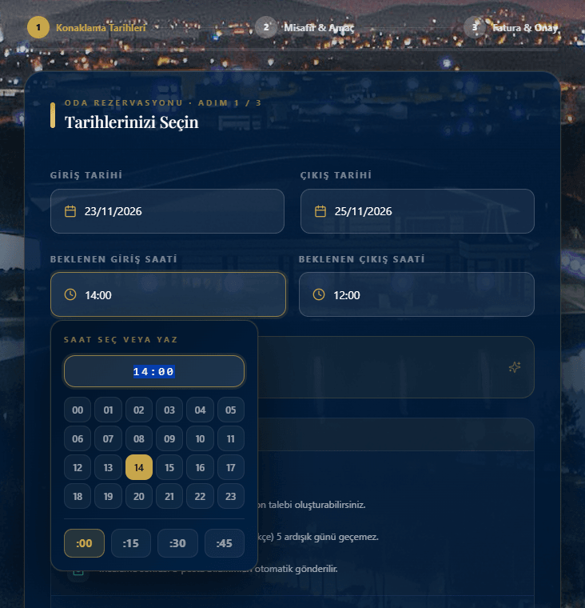

Kurala uymayan bir tarih seçtiyseniz **İleri**'ye tıkladığınızda uyarı görürsünüz. Bu durumda tarihleri değiştirin.

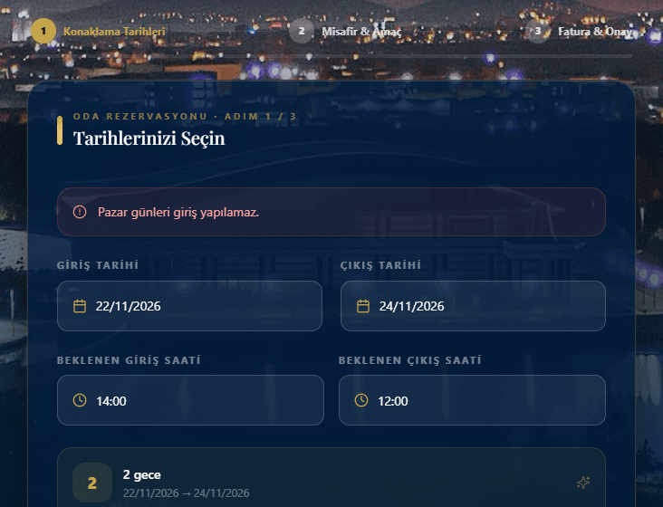

### 5.2 Adım 2: Misafir ve amaç

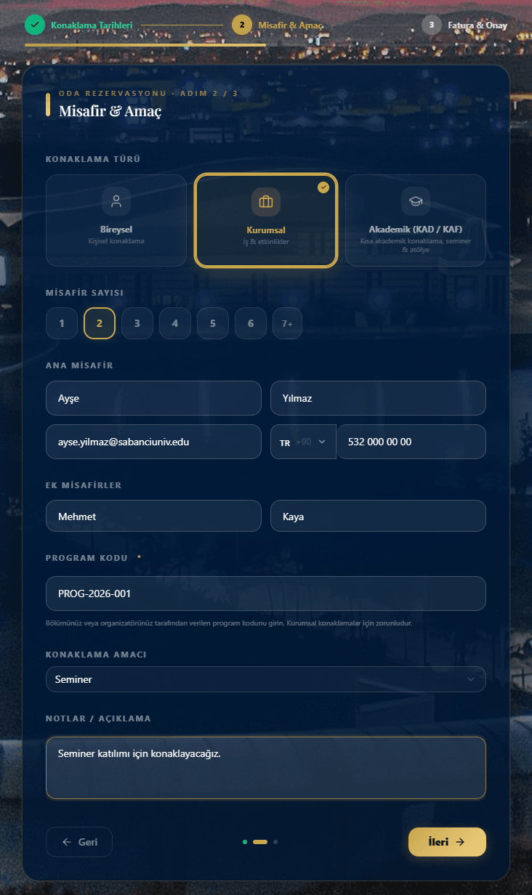

1. **Konaklama Türü** seçin:

   | Tür | Ne zaman seçilir | Ek olarak istenen |
   |---|---|---|
   | Bireysel | Kişisel konaklama. Listelerde "Kişisel" olarak görünür. | En fazla 5 gece |
   | Kurumsal | İş veya etkinlik amaçlı konaklama | **Program Kodu** (bölümünüz veya organizatörünüz verir) |
   | Akademik (KAD / KAF) | Kısa akademik konaklama, seminer ve atölye. Listelerde "Eğitim" olarak görünür. | **Notlar / Açıklama** alanı |

2. **Misafir Sayısı**'nı seçin. 7 ve üzeri için **7+**'ya tıklayıp sayıyı yazın (en fazla 10).
3. **Ana Misafir** bilgilerini kontrol edin. Ad ve e-posta hesabınızdan gelir. **Telefon** numarasını ülke kodunu seçerek siz yazarsınız.
4. Birden fazla misafir varsa **Ek Misafirler** bölümüne herkesin adını ve soyadını yazın.
5. **Konaklama Amacı**'nı listeden seçin: Konferans, Seminer, Atölye, Eğitim, Toplantı, Kişisel veya Diğer.
6. **Notlar / Açıklama** alanına otele iletmek istediklerinizi yazın. Ekranda sicil numarası uyarısı görüyorsanız sicil numaranızı (velilerin öğrencinin sicil numarasını) bu alana yazın.
7. **İleri**'ye tıklayın.

### 5.3 Adım 3: Fatura ve onay

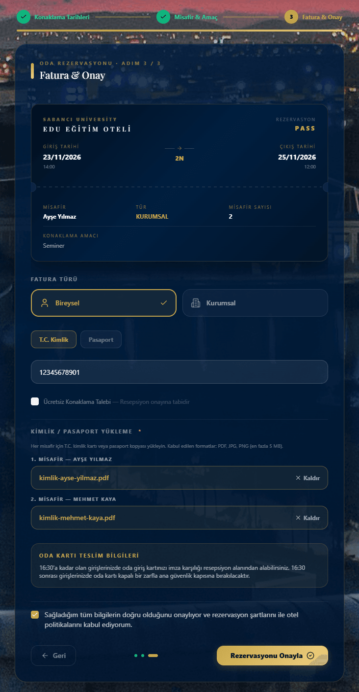

1. Üstteki özet kartta tarihleri, misafir sayısını ve konaklama türünü kontrol edin. Yanlış bir bilgi varsa **Geri** ile düzeltin.
2. **Fatura Türü** seçin:
   - **Bireysel:** **T.C. Kimlik** veya **Pasaport** seçip numarayı yazın.
   - **Kurumsal:** **Vergi Numarası**, **Şirket / Kurum Adı** ve **Fatura Adresi** alanlarını doldurun.
3. Ücretsiz konaklama hakkınız olduğunu düşünüyorsanız **Ücretsiz Konaklama Talebi** kutusunu işaretleyin. Bu seçenek resepsiyon onayına tabidir, konaklamanızı kendiliğinden ücretsiz yapmaz. Sonucu için onay e-postanıza bakın veya otele sorun.
4. **Kimlik / Pasaport Yükleme** bölümünde her misafir için **Dosya seçin...** alanına tıklayıp belgeyi yükleyin. PDF, JPG veya PNG kabul edilir ve her dosya en fazla 5 MB olabilir. Başka türde bir dosya seçerseniz belge kaydedilmez ve uyarı da çıkmaz, bu yüzden dosya türünü kontrol edin. Yanlış dosyayı **Kaldır** ile silebilirsiniz.
5. **Oda Kartı Teslim Bilgileri**'ni okuyun. Ayrıntılar için bkz. [Otele giriş ve oda kartı](#12-otele-giriş-ve-oda-kartı).
6. Onay kutusunu işaretleyin ve **Rezervasyonu Onayla**'ya tıklayın.

### 5.4 Talebi gönderdikten sonra

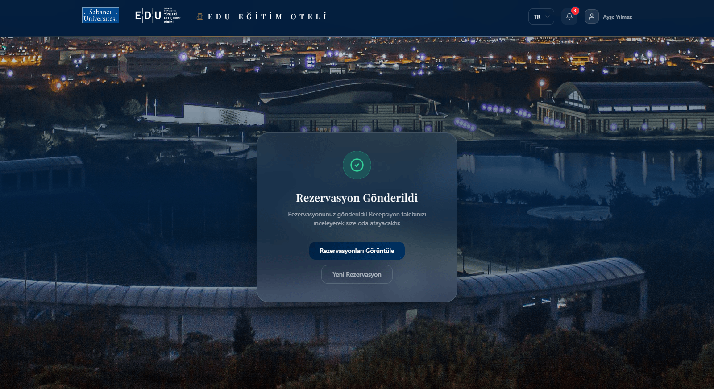

"Rezervasyon Gönderildi" ekranı talebinizin alındığını gösterir ve size "talebiniz alındı" e-postası gelir. **Rezervasyonu Onayla** düğmesinin adına rağmen bu aşamada konaklamanız henüz kesinleşmemiştir. Otel talebinizi inceler ve sonucu e-postayla bildirir. Durumu [Rezervasyonlarım](#6-rezervasyonlarım) sayfasından da takip edebilirsiniz.

---

## 6. Rezervasyonlarım

Oluşturduğunuz tüm talepleri, en yenisi üstte olacak şekilde listeler. Ödemeye geçme ve iptal işlemleri bu sayfadan yapılır.

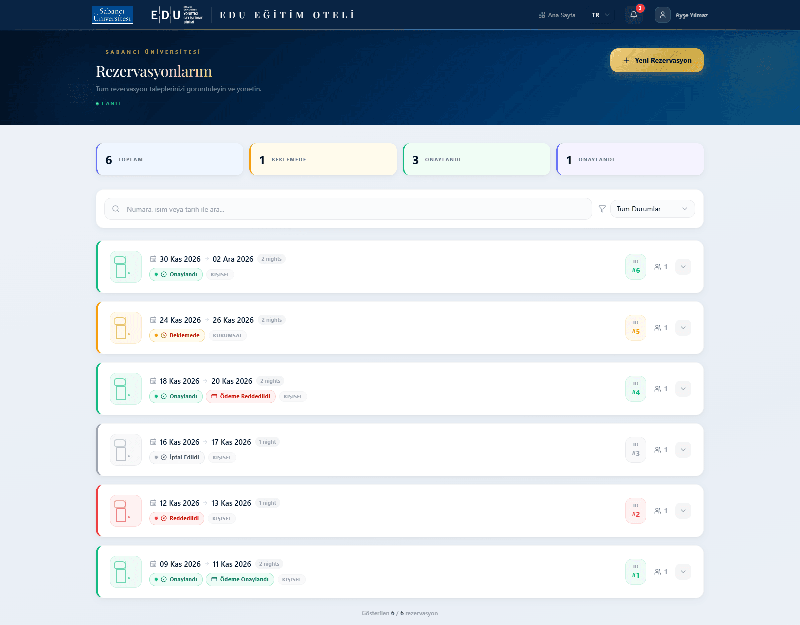

Üstteki dört kart sırasıyla toplam, beklemedeki, onaylanmış ve ödemesi onaylanmış rezervasyon sayılarını gösterir. Son iki kartın ikisinde de "Onaylandı" yazar. Sağdaki mor kart ödemesi onaylanmış olanları sayar.

Her satırda tarihler, gece sayısı, rezervasyon durumu, varsa ödeme durumu, konaklama türü, rezervasyon numarası ve misafir sayısı yer alır. Sayfa açıkken liste 30 saniyede bir kendiliğinden güncellenir. Talebiniz onaylanırsa ekranda ayrıca bir uyarı çıkar.

### 6.1 Arama ve filtreleme

- Arama kutusuna rezervasyon numarasını, misafir adını veya tarihi yazın.
- Sağdaki listeden duruma göre süzün: **Tüm Durumlar**, **Beklemede**, **Onaylandı**, **Reddedildi**, **İptal Edildi**, **İade Talep Edildi**, **İade Edildi**.

### 6.2 Rezervasyon detayı

Satıra tıklayın. Açılan bölümde misafir bilgileri, konaklama detayları ve fatura bilgileri ile notlar yer alır. Tekrar tıklayınca bölüm kapanır.

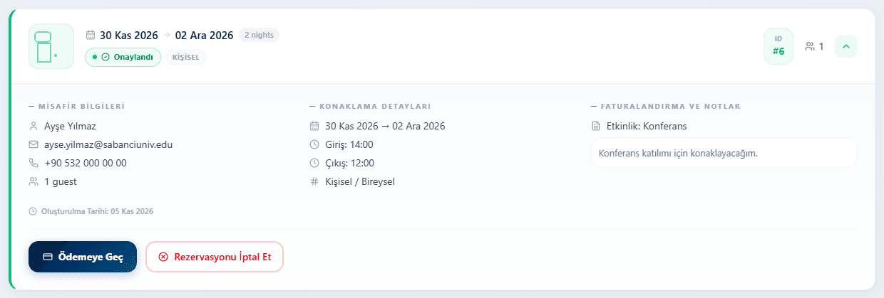

Oda atandıktan sonra oda numaranız **Konaklama Detayları** bölümünde görünür. Birden fazla oda atandıysa odaların tamamı oda atama e-postasında yazar.

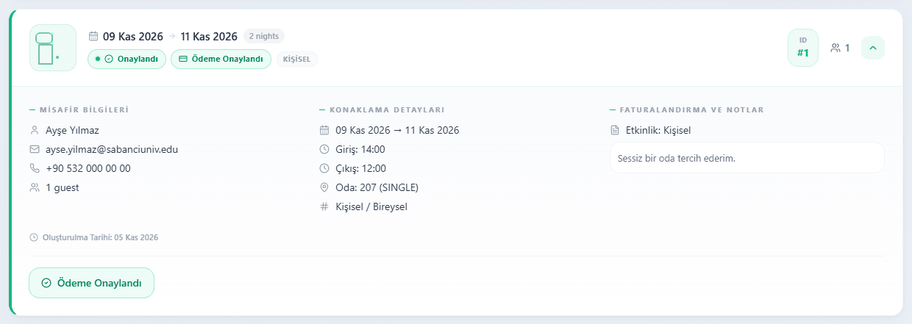

Reddedilen bir talebin detayında otelin yazdığı **Red Gerekçesi** görünür.

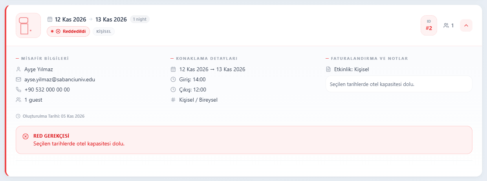

Detayın altında rezervasyonun durumuna göre şunları görürsünüz:

| Durum | Görünenler |
|---|---|
| Beklemede | **Rezervasyonu İptal Et** |
| Onaylandı, dekont yüklenmedi | **Ödemeye Geç**, **Rezervasyonu İptal Et** |
| Dekont doğrulanıyor | **Ödeme Doğrulaması Bekleniyor** yazısı, **Rezervasyonu İptal Et** |
| Ödeme reddedildi | **Ödemeye Geç**, **Rezervasyonu İptal Et** |
| Ödeme onaylandı | **Ödeme Onaylandı** yazısı |

### 6.3 Rezervasyonu iptal etme

1. Rezervasyonun detayını açın ve **Rezervasyonu İptal Et**'e tıklayın.
2. Açılan kutuya iptal sebebini yazın. Sebep yazmak isteğe bağlıdır.
3. **OK**'a tıklayın. Vazgeçmek için **Cancel**'a tıklayın. Düğmelerin adı tarayıcınıza göre değişebilir.

Rezervasyon **İptal Edildi** durumuna geçer ve size e-posta gelir. İptal geri alınamaz. Fikrinizi değiştirirseniz yeni bir talep oluşturmanız gerekir.

Dikkat edilecekler:

- Giriş tarihine 24 saatten az kaldıysa düğme görünmeye devam eder ama iptal yapılmaz ve "İptaller, giriş tarihinden en az 24 saat önce yapılmalıdır" uyarısı çıkar. Süre, seçtiğiniz giriş saatinden değil, giriş gününün başından (Türkiye saatiyle 03:00) hesaplanır. Bu yüzden iptali son güne bırakmayın.
- Dekont yükledikten sonra iptal ederseniz ödemenizin iadesi kendiliğinden yapılmaz. İade için otelle iletişime geçin.
- Ödemesi onaylanmış bir rezervasyon site üzerinden iptal edilemez. Bu durumda ve 24 saatten az kaldığında [otelle iletişime geçin](#11-destek-ve-iletişim).

---

## 7. Ödeme

Ödeme banka havalesiyle yapılır. Talebiniz onaylanıp fiyatı belirlendikten sonra havaleyi yapar ve dekontu bu sayfadan yüklersiniz.

Sayfayı **Ana Sayfa**'daki veya rezervasyon detayındaki **Ödemeye Geç** düğmesiyle açın.

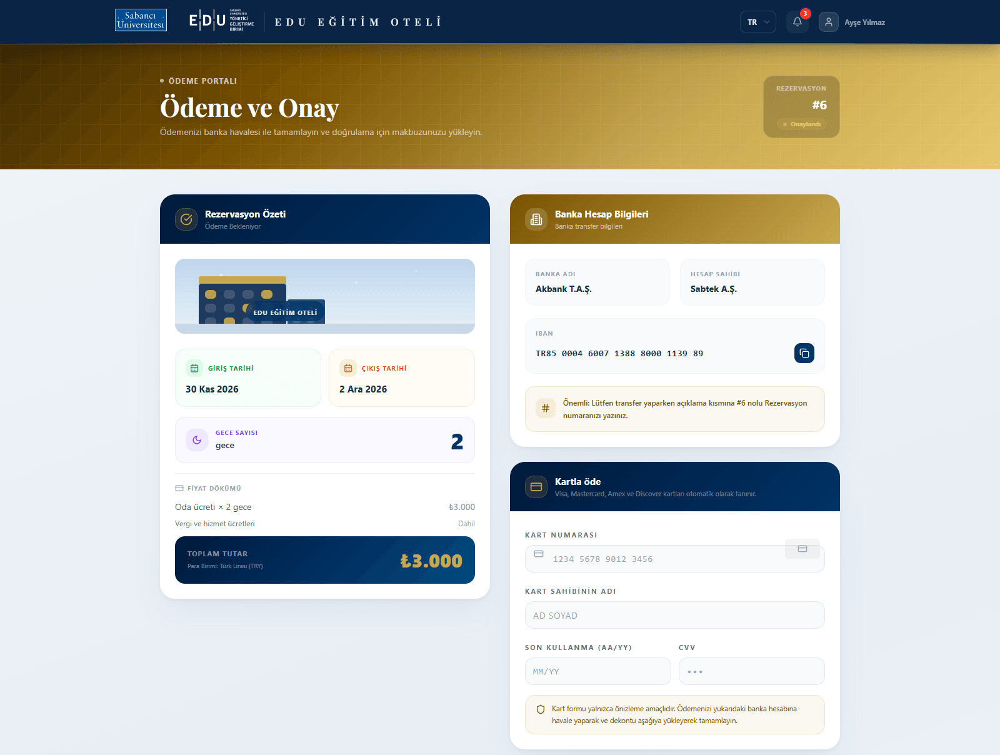

**Önemli: Doğru rezervasyonda olduğunuzu kontrol edin.** Ödeme sayfası, hangi rezervasyondan gelirseniz gelin her zaman **en son oluşturduğunuz** rezervasyonu açar. Sağ üstteki **Rezervasyon** kutusunda yazan numaraya bakın. Bu numara ödemek istediğiniz rezervasyonun numarası değilse dekont yüklemeyin ve [otelle iletişime geçin](#11-destek-ve-iletişim). Sorun yaşamamak için bekleyen bir ödemeniz varken yeni talep oluşturmamaya çalışın.

### 7.1 Havale yapma

1. **Rezervasyon Özeti**'nde tarihleri ve **Toplam Tutar**'ı kontrol edin. Toplam tutar, otelin bu konaklama için belirlediği ücrettir.
2. **Banka Hesap Bilgileri**'ndeki banka adı, hesap sahibi ve IBAN'ı kullanarak bankanızdan havale yapın. IBAN'ın yanındaki düğmeyle IBAN'ı kopyalayabilirsiniz.
3. Havale açıklamasına rezervasyon numaranızı yazın. Numara sarı uyarı kutusunda yazar.
4. İşlemden sonra bankanızın verdiği dekontu kaydedin.

### 7.2 Dekont yükleme

1. **Ödeme Dekontu Yükle** bölümünde kutuya tıklayıp dosyayı seçin veya dosyayı kutunun üzerine sürükleyin. PDF, JPG veya PNG kabul edilir ve dosya en fazla 5 MB olabilir.
2. Dosya adının ve "Dosya yüklemeye hazır" yazısının göründüğünü kontrol edin. Yanlış dosyayı kırmızı çarpıyla kaldırabilirsiniz.
3. **Dekontu İncelemeye Gönder**'e tıklayın.

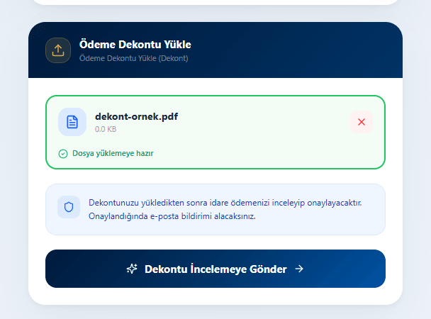

"Ödeme dekontu başarıyla gönderildi!" mesajını onayladıktan sonra Ana Sayfa açılır. Ödemeniz **Ödeme Doğrulanıyor** durumuna geçer ve size e-posta gelir. Otel dekontu kontrol edip sonucu e-postayla bildirir.

Ekranda **Fiyat henüz belirlenmedi** uyarısı görürseniz gönder düğmesi çalışmaz. Otelin talebinizi onaylayıp fiyatı belirlemesini bekleyin. Süre uzarsa otelle iletişime geçin.

### 7.3 Dekontunuz reddedilirse

Otel dekontu kabul etmezse size sebebiyle birlikte e-posta gelir ve rezervasyonda **Ödeme Reddedildi** yazar. Tutarın doğru ve dekontun okunaklı olduğundan emin olun. Ardından **Ödemeye Geç** ile sayfayı tekrar açıp yeni dekont yükleyin. Bu durumda da yukarıdaki rezervasyon numarası kontrolünü yapın.

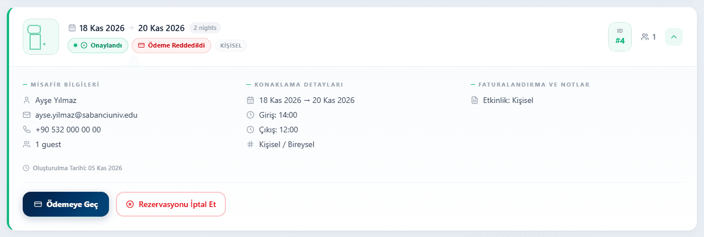

### 7.4 Kartla ödeme formu

Sayfadaki **Kartla öde** formu yalnızca önizleme amaçlıdır. Bu formla ödeme alınmaz. Kart bilgilerinizi buraya girmeyin, ödemenizi havaleyle yapın.

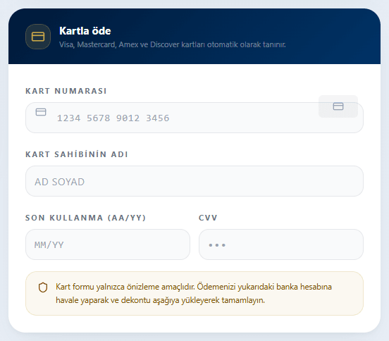

---

## 8. Bildirimler

Bildirimler, rezervasyonlarınızdaki değişiklikleri site içinde gösterir. E-postalardan ayrıdır, ikisini de kontrol edebilirsiniz.

### 8.1 Bildirim zili

Üst çubuktaki zile tıklayın. Son 8 bildirim açılır. Zilin üzerindeki kırmızı sayı, bu 8 bildirimden okunmamış olanları gösterir.

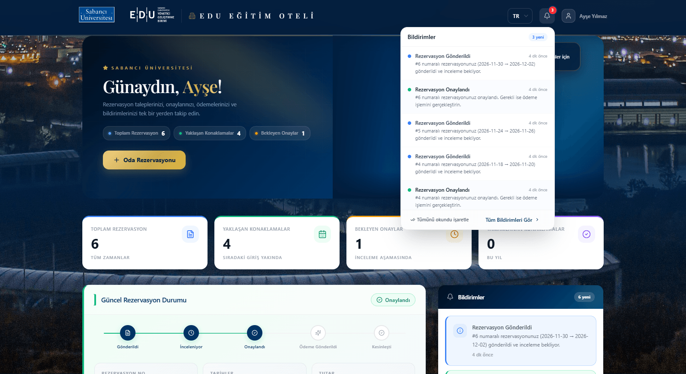

Bir bildirime tıklarsanız okundu sayılır ve [Rezervasyonlarım](#6-rezervasyonlarım) açılır. **Tümünü okundu işaretle** hepsini okundu yapar. **Tüm Bildirimleri Gör** bildirimler sayfasını açar.

### 8.2 Bildirimler sayfası

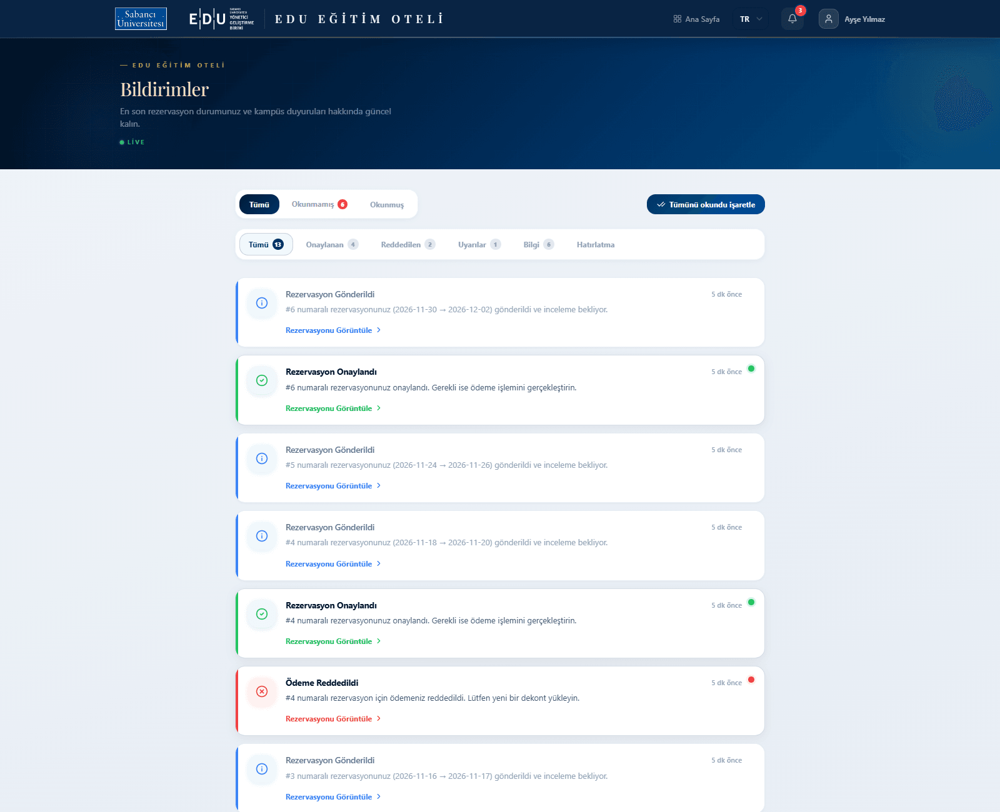

- Üstteki düğmelerle okunma durumuna göre süzün: **Tümü**, **Okunmamış**, **Okunmuş**.
- Alttaki düğmelerle türe göre süzün: **Tümü**, **Onaylanan**, **Reddedilen**, **Uyarılar**, **Bilgi**, **Hatırlatma**.
- **Rezervasyonu Görüntüle** ilgili sayfayı açar.

Okundu bilgisi kullandığınız tarayıcıda tutulur. Başka bir cihazdan girerseniz aynı bildirimler okunmamış görünebilir.

Görebileceğiniz bildirimler:

| Bildirim | Ne zaman |
|---|---|
| Rezervasyon Gönderildi | Talep oluşturduğunuzda |
| Rezervasyon Onaylandı | Otel talebinizi onayladığında |
| Rezervasyon Reddedildi | Otel talebinizi reddettiğinde |
| Rezervasyon İptal Edildi | Rezervasyonunuzu iptal ettiğinizde |
| Ödeme Dekontu Yüklendi | Dekont yükleyip doğrulama beklerken |
| Ödeme Onaylandı | Otel ödemenizi onayladığında |
| Ödeme Reddedildi | Otel dekontunuzu kabul etmediğinde |
| Giriş Hatırlatması | Onaylı rezervasyonunuzun girişine 48 saatten az kaldığında |

---

## 9. Atlas Konsiyerj

Atlas, Ana Sayfa'daki otel görevlisi figürüdür. Sık sorulan sorulara yanıt verir ve resepsiyona talep iletmenizi sağlar. Figüre veya yanındaki konuşma balonuna tıklayarak açın. Kapatmak için paneldeki çarpıya tıklayın. Atlas tablet ve bilgisayarda görünür, telefonda görünmez.

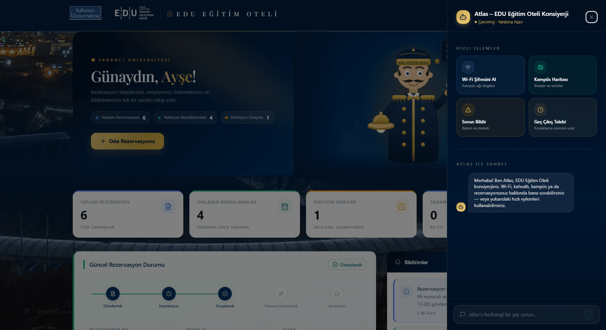

Panelin üstündeki **Hızlı İşlemler**:

| Düğme | Ne yapar |
|---|---|
| Wi-Fi Şifresini Al | Otelin Wi-Fi ağ adını ve şifresini gösterir. **Kopyala** ile kopyalayabilirsiniz. |
| Kampüs Haritası | Tuzla kampüs haritasını açar. Yakınlaştırmak için haritaya tıklayın, kapatmak için dışarı tıklayın. Esc tuşu haritayla birlikte Atlas panelini de kapatır. |
| Sorun Bildir | Oda veya tesisle ilgili sorunu resepsiyona iletir. |
| Geç Çıkış Talebi | Geç çıkış isteğinizi resepsiyona iletir. |

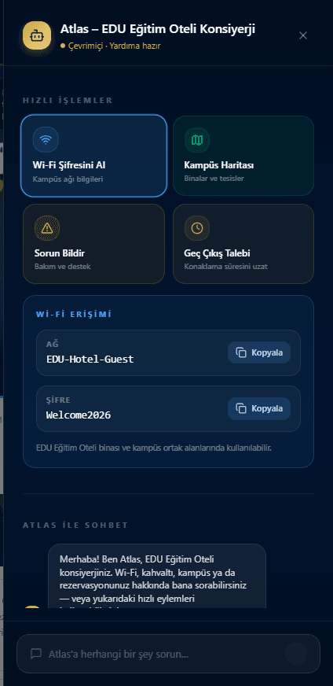

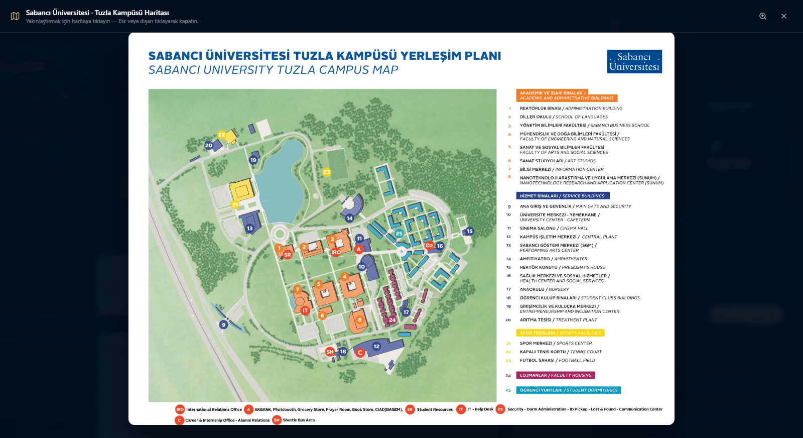

### 9.1 Sorun bildirme veya geç çıkış isteme

1. **Sorun Bildir** veya **Geç Çıkış Talebi**'ne tıklayın.
2. Sorun için kısa bir başlık ve açıklama yazın, oda numaranızı da belirtin. Geç çıkış için rezervasyon numaranızı, istediğiniz saati ve sebebi yazın. Açıklama zorunludur.
3. **Resepsiyona gönder**'e tıklayın.

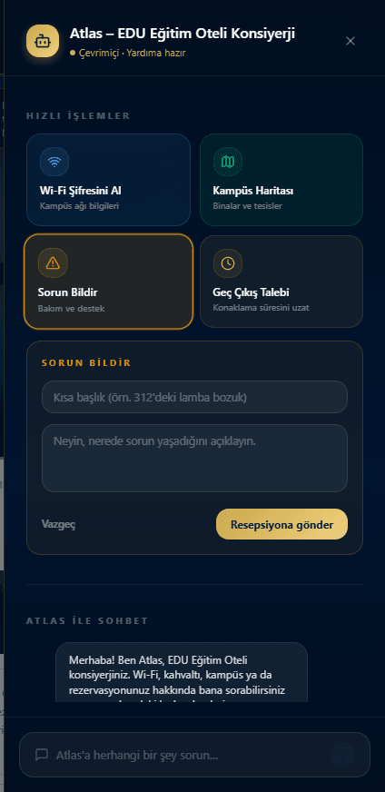

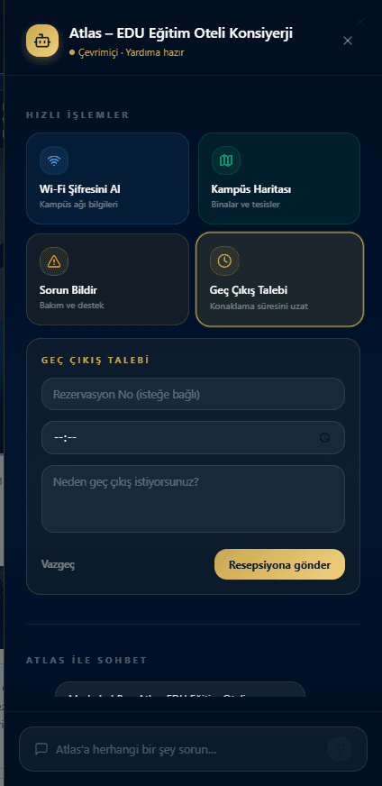

Talebiniz, adınız ve hesabınızdaki e-posta adresiyle birlikte resepsiyona e-postayla iletilir. Oda veya rezervasyon numarası otomatik eklenmez, bu yüzden mesajınıza yazın. Geç çıkış müsaitliğe bağlıdır, talep göndermek onaylandığı anlamına gelmez.

### 9.2 Atlas ile sohbet

Panelin altındaki kutuya sorunuzu yazın. Atlas gerçek bir görevli değildir. Kahvaltı, kampüs, ulaşım ve iptal gibi konularda hazır yanıtlar verir.

**Sohbete yazdıklarınız resepsiyona iletilmez.** Atlas "resepsiyon ekibine ileteceğim" yanıtını verse bile mesajınız kimseye ulaşmaz. Resepsiyona ulaşmak için **Sorun Bildir** veya **Geç Çıkış Talebi** formlarını ya da [Destek İletişim](#11-destek-ve-iletişim) kanallarını kullanın. Wi-Fi bilgisi için de sohbet yanıtı yerine **Wi-Fi Şifresini Al** düğmesini kullanın.

---

## 10. Profil

Üst çubuktaki adınıza tıklayarak açılır. Hesap bilgilerinizi görebilir ve çıkış yapabilirsiniz.

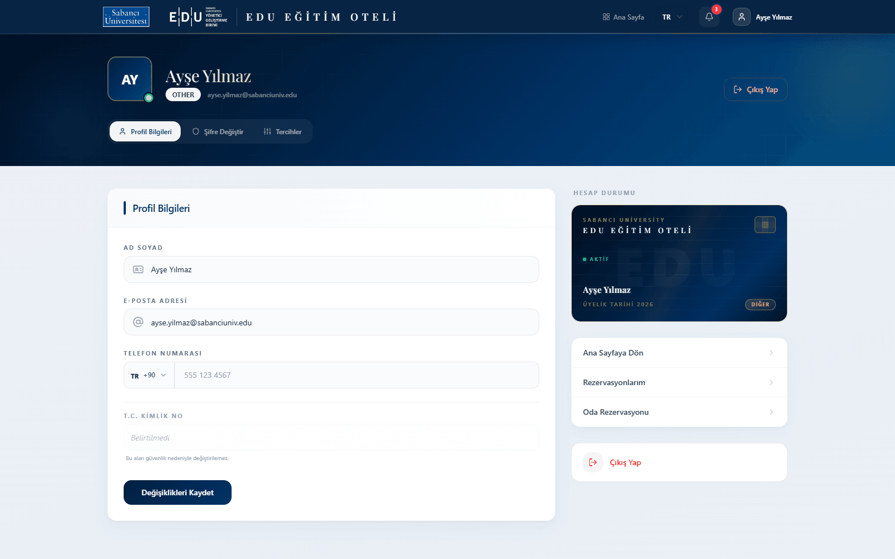

Sayfada üç sekme bulunur:

- **Profil Bilgileri:** adınız, e-postanız, telefonunuz ve T.C. kimlik numaranız.
- **Şifre Değiştir:** şifre kuralları ve şifre alanları.
- **Tercihler:** e-posta bildirimlerinin açık, SMS bildirimlerinin kapalı olduğunu gösterir. Bu ayarlar buradan değiştirilemez.

Sağ tarafta üyelik kartınız, **Ana Sayfaya Dön**, **Rezervasyonlarım** ve **Oda Rezervasyonu** kısayolları ile **Çıkış Yap** düğmesi yer alır.

**Önemli:** **Değişiklikleri Kaydet** ve **Şifreyi Güncelle** düğmeleri şu anda değişiklikleri kaydetmez. Ekranda bir hata görmeseniz de bilgileriniz değişmez.

- **Şifrenizi değiştirmek için** çıkış yapın ve giriş sayfasındaki [Şifrenizi mi unuttunuz?](#şifrenizi-unuttuysanız) adımlarını izleyin.
- **Ad, e-posta veya telefon değişikliği için** [otelle iletişime geçin](#11-destek-ve-iletişim). Rezervasyonda kullanılacak ad, e-posta ve telefonu talep formunda ayrıca yazabilirsiniz.

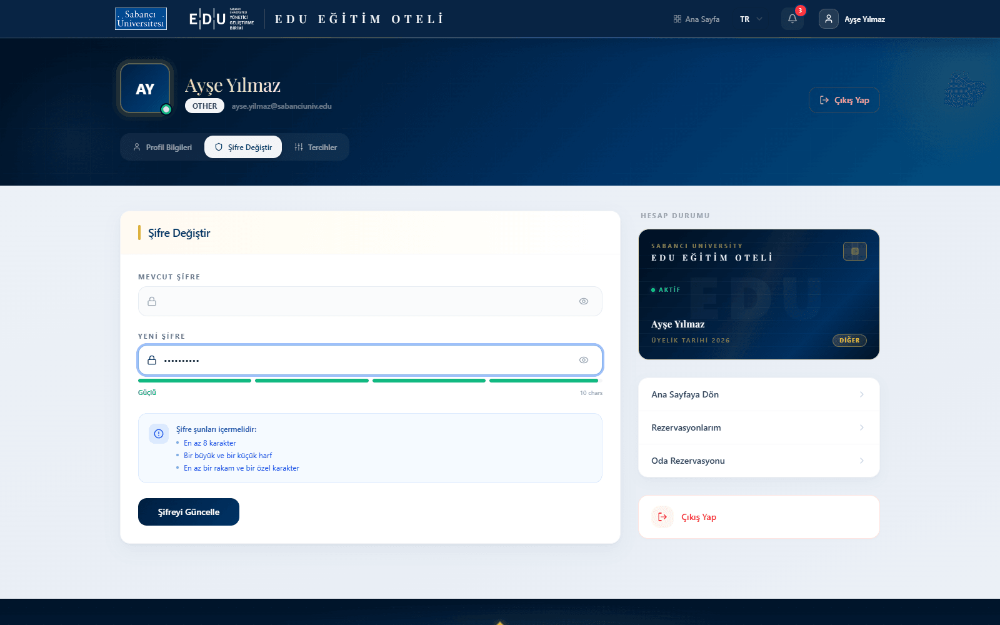

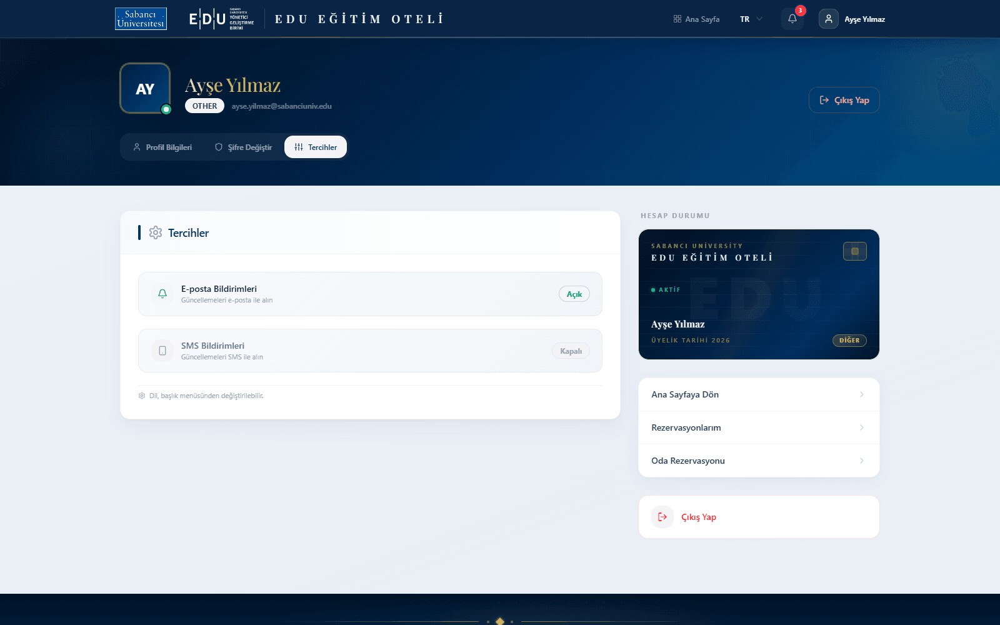

---

## 11. Destek ve iletişim

Otelin iletişim kanallarını gösterir. **Hızlı İşlemler** bölümündeki **Destekle İletişime Geç** kısayoluyla veya sayfa altındaki bağlantıyla açılır.

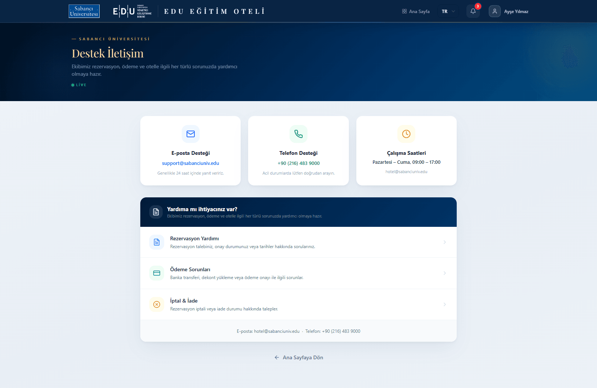

| Kanal | Bilgi | Not |
|---|---|---|
| E-posta desteği | support@sabanciuniv.edu | Genellikle 24 saat içinde yanıt verilir. |
| Otel e-postası | hotel@sabanciuniv.edu | Otelden gelen e-postalarda da bu adres yazar. |
| Telefon | +90 (216) 483 9000 | Acil durumlarda doğrudan arayın. |
| Çalışma saatleri | Pazartesi – Cuma, 09:00 – 17:00 | |

Sayfadaki **Rezervasyon Yardımı**, **Ödeme Sorunları** ve **İptal & İade** başlıkları hangi konularda yardım alabileceğinizi gösterir, tıklanınca bir sayfa açmaz. Hızlı yanıt almak için mesajınıza rezervasyon numaranızı yazın.

---

## 12. Otele giriş ve oda kartı

Konaklamanız, otel ödemenizi onayladığında kesinleşir. Oda numaranızı oda atama e-postasından ve [Rezervasyonlarım](#6-rezervasyonlarım) sayfasından öğrenebilirsiniz. Oda henüz atanmadıysa "Rezervasyonunuz kesinleşti" e-postasında odanın girişte bildirileceği yazar.

Oda kartınızı giriş saatinize göre alırsınız:

| Giriş saati | Oda kartı nereden alınır |
|---|---|
| 16:30'a kadar | Resepsiyondan, imza karşılığında |
| 16:30'dan sonra | Ana güvenlik kapısından, kapalı zarfla |

Girişte yanınızda geçerli bir kimlik belgesi bulundurun.

Standart giriş ve çıkış saatleri rezervasyon formunda hazır gelir (giriş 14:00, çıkış 12:00). Otel bu saatleri değiştirebilir. Geç çıkış için [Atlas Konsiyerj](#91-sorun-bildirme-veya-geç-çıkış-isteme) üzerinden talep gönderin.

---

## 13. Sık sorulan sorular

**Kayıt olurken "@sabanciuniv.edu" uyarısı alıyorum.**
Kayıt yalnızca bu uzantılı adreslerle yapılabilir. Böyle bir adresiniz yoksa [otelle iletişime geçin](#11-destek-ve-iletişim). Otel rezervasyonunuzu sizin adınıza girerse, verdiğiniz e-posta adresiyle [Şifrenizi mi unuttunuz?](#şifrenizi-unuttuysanız) adımlarını izleyerek şifre belirleyebilir ve giriş yapabilirsiniz.

**Şifrem kabul edilmiyor.**
Ekranda "En az 8 karakter" yazsa da şifrede en az bir büyük harf, bir küçük harf, bir rakam ve bir özel karakter bulunmalıdır.

**"Hesabınız kara listeye alınmıştır" uyarısı alıyorum.**
Bu durumda giriş yapamazsınız ve talep oluşturamazsınız. Bilgi almak için [otelle iletişime geçin](#11-destek-ve-iletişim).

**Rezervasyonlarım boş görünüyor.**
Büyük olasılıkla 1 saatlik oturum süreniz doldu. Rezervasyonlarınız silinmemiştir. [Profil](#10-profil) sayfasından çıkış yapıp tekrar giriş yapın.

**Oda seçebilir miyim?**
Hayır. Odaları otel atar. Tercihinizi talep formundaki **Notlar / Açıklama** alanına yazabilirsiniz.

**Pazar giriş yapmam gerekiyor ama form izin vermiyor.**
Pazar girişi ve Cumartesi giriş ile Pazar çıkış birleşimi sistem tarafından kabul edilmez. Özel bir durumunuz varsa otelle iletişime geçin.

**30 günden daha ileri bir tarih için ya da 5 geceden uzun kalmak istiyorum.**
Bu sınırlar sistem tarafından uygulanır. [Otelle iletişime geçin](#11-destek-ve-iletişim). 5 gece sınırı yalnızca bireysel konaklamalar için geçerlidir.

**"Ödemeye Geç" düğmesi soluk görünüyor veya tıklanmıyor.**
Talebiniz henüz onaylanmamış, fiyatı belirlenmemiş veya dekontunuz zaten yüklenmiş olabilir. Ana Sayfa'daki düğme yalnızca en son oluşturduğunuz rezervasyon için geçerlidir. Önceki rezervasyonlarınız için [Rezervasyonlarım](#6-rezervasyonlarım) sayfasına bakın.

**Ödeme sayfasında başka bir rezervasyon görünüyor.**
Ödeme sayfası her zaman en son oluşturduğunuz rezervasyonu açar. Dekont yüklemeyin ve [otelle iletişime geçin](#11-destek-ve-iletişim).

**Yanlış dekont yükledim.**
Dekont gönderildikten sonra **Ödemeye Geç** düğmesi kapanır. Rezervasyon numaranızla birlikte otele haber verin. Otel dekontu reddederse yenisini yükleyebilirsiniz.

**Dekont yüklerken dosya kabul edilmiyor.**
Dosya PDF, JPG veya PNG olmalı ve 5 MB'ı geçmemelidir.

**Rezervasyonumu iptal edemiyorum.**
Girişe 24 saatten az kalmış veya ödemeniz onaylanmış olabilir. Bu durumlarda [otelle iletişime geçin](#11-destek-ve-iletişim). İade talepleri de otel üzerinden yürütülür.

**Bilgilerimi Profil sayfasında değiştirdim ama eski haline döndü.**
Profil sayfasındaki kaydetme düğmeleri şu anda çalışmaz. Bkz. [Profil](#10-profil).

**Atlas'a yazdım ama dönüş olmadı.**
Sohbet mesajları resepsiyona iletilmez. **Sorun Bildir** veya **Geç Çıkış Talebi** formunu kullanın ya da otelle doğrudan iletişime geçin.

**E-posta gelmiyor.**
Gereksiz (spam) klasörünüze bakın. Talep durumunuzu [Rezervasyonlarım](#6-rezervasyonlarım) ve [Bildirimler](#8-bildirimler) sayfalarından her zaman görebilirsiniz.

---

## 14. Ek: Size otomatik gelen e-postalar

Aşağıdaki e-postalar sistem tarafından otomatik gönderilir. E-postalar, sitede seçtiğiniz dile göre Türkçe veya İngilizce gelir.

| Ne zaman | Konu |
|---|---|
| Talep oluşturduğunuzda | EDU Hotel – Rezervasyon talebi alındı |
| Otel talebinizi onayladığında | EDU Hotel – Rezervasyon onaylandı |
| Otel talebinizi reddettiğinde | EDU Hotel – Rezervasyon reddedildi |
| Dekont yüklediğinizde | EDU Hotel – Ödeme dekontu alındı |
| Otel ödemenizi onayladığında | EDU Hotel – Rezervasyonunuz kesinleşti |
| Otel dekontunuzu kabul etmediğinde | EDU Hotel – Ödeme dekontu kabul edilmedi |
| Otel oda atadığında | EDU Hotel – Oda atandı |
| Rezervasyonunuzu iptal ettiğinizde | EDU Hotel – Rezervasyon iptal edildi |
| Şifre sıfırlama istediğinizde | EDU Hotel – Şifrenizi sıfırlayın |

Şifre sıfırlama dışındaki e-postaların konusunun sonunda rezervasyon numarası yer alır. "Rezervasyonunuz kesinleşti" konusunda ✓ işareti de bulunur. Birden fazla oda atandıysa konu "Odalar atandı" olur. Otel, şifre sıfırlama dışındaki e-postaları geçici olarak kapatabilir. Beklediğiniz bir e-posta gelmezse durumu sitedeki sayfalardan kontrol edin.
