# EDU Education Hotel Guest User Guide

This guide is for guests who want to stay at EDU Education Hotel. It explains, step by step, how to create an account, submit a reservation request, make a payment, track or cancel a reservation and get help during your stay.

The screenshots were taken with sample data and show the Turkish interface. You can switch the site to English with the **TR** / **EN** selector at the top of the screen. Button and field names in this guide refer to the English interface. Names, dates, amounts and bank details on your screen may differ from the screenshots. When paying, always use the details shown on your own screen.

## Contents

1. [Creating an account, signing in and out](#1-creating-an-account-signing-in-and-out)
2. [Getting to know the screen](#2-getting-to-know-the-screen)
3. [The life of a reservation](#3-the-life-of-a-reservation)
4. [Main Page](#4-main-page)
5. [Book a Room](#5-book-a-room)
6. [My Reservations](#6-my-reservations)
7. [Payment](#7-payment)
8. [Notifications](#8-notifications)
9. [Atlas Concierge](#9-atlas-concierge)
10. [Profile](#10-profile)
11. [Contact Support](#11-contact-support)
12. [Arrival and key card](#12-arrival-and-key-card)
13. [Frequently asked questions](#13-frequently-asked-questions)
14. [Appendix: Automatic emails you receive](#14-appendix-automatic-emails-you-receive)

---

## 1. Creating an account, signing in and out

The **Log In** and **Book Now** buttons on the hotel's landing page take you to the sign-in page.

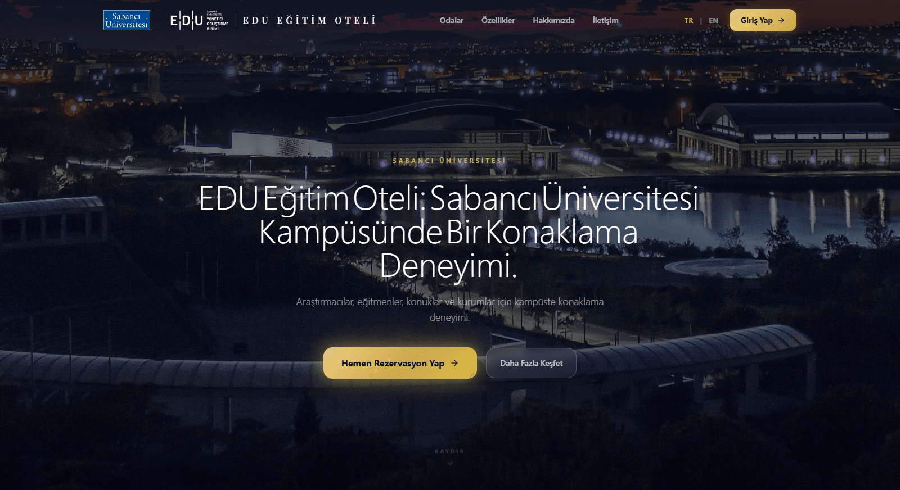

### Creating an account

1. Click **Create account** at the bottom of the sign-in page.
2. Fill in **Full Name**, **Email Address**, **Password** and **Confirm Password**.
3. Tick the KVKK (data protection) consent box. Click **Read details** to read the full text.
4. Click **Create account**.

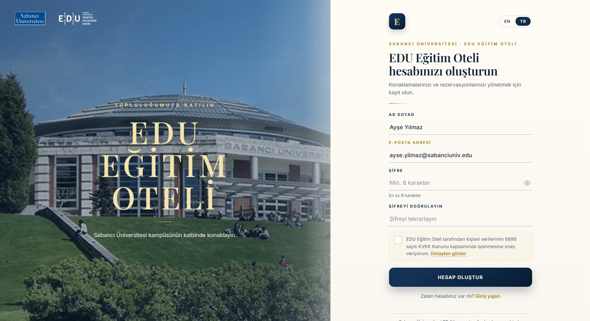

No separate confirmation message appears. You are taken straight to the sign-in page, where you can sign in with your email and password.

Good to know:

- You can only sign up with an **@sabanciuniv.edu** email address. With any other address you will see "Please use your @sabanciuniv.edu email address." If you do not have one, [contact the hotel](#11-contact-support) to make a reservation.
- Your password must be at least 8 characters and include at least one uppercase letter, one lowercase letter, one number and one special character. For example, `Sample!2026` follows this rule.

### Signing in

1. Fill in **Email Address** and **Password**.
2. Click **Sign in**.

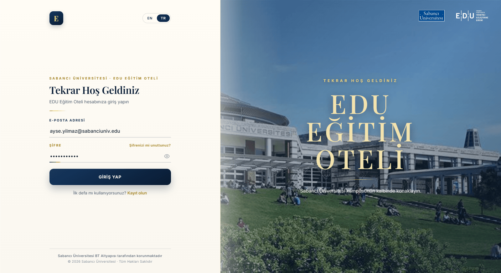

To see your password, click the eye icon at the right of the field.

If too many attempts are made in a short time (10 attempts in 15 minutes), a "Too many attempts" warning appears and the action is temporarily blocked. Sign-in, sign-up and password reset attempts all count toward this number. Attempts by other users may also affect you. If you see this warning, try again after 15 minutes.

### If you forgot your password

1. Click **Forgot password?** on the sign-in page.
2. Type your registered email address and click **Send reset link**.

   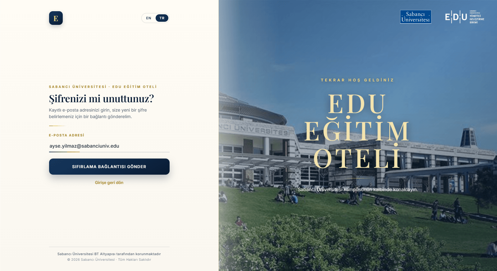

3. Click the button in the "EDU Hotel – Reset your password" email. The link is valid for 1 hour. If you request another link, only the newest one works.
4. Type your new password twice and click **Update password**. The new password must also follow the password rule above.

   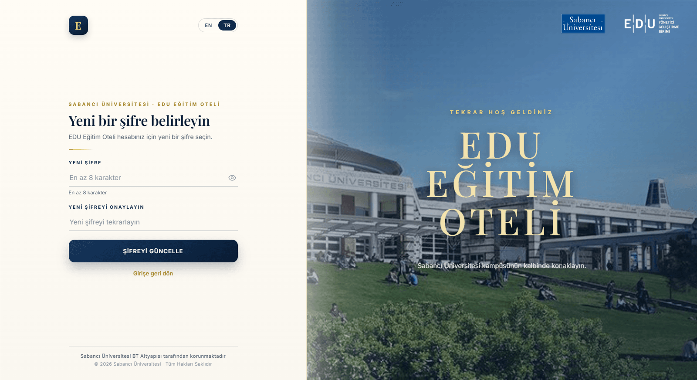

When you are done, you are taken to the sign-in page after a short moment. If the email does not arrive, check your spam folder first.

### Session length

- Your session is valid for 1 hour after you sign in. After that you need to sign in again.
- When the session ends, the system does not take you to the sign-in page by itself. If pages look empty, your reservations have not been deleted. Log out and sign in again. For example, **My Reservations** may say "No reservations yet", the Main Page cards may show 0, and the **Payment** page may say "No active reservation found."
- Closing the tab or the browser does not end the session right away. Always log out on a shared computer.

### Signing out

Click your name in the top right corner to open the [Profile](#10-profile) page and click **Logout**. You return to the landing page.

---

## 2. Getting to know the screen

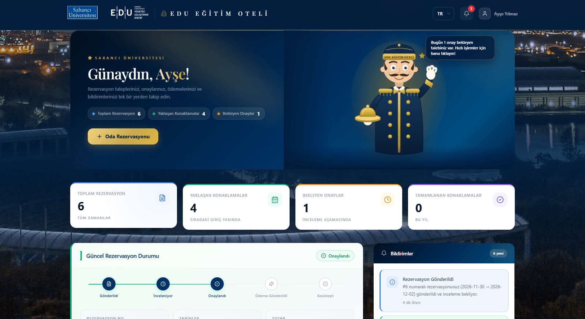

Most pages have three parts:

**Top bar.** Shown on every page. Click the logos on the left to return to the [Main Page](#4-main-page). On the right are the language selector (**TR** / **EN**), the notification bell and your name. Clicking your name opens the [Profile](#10-profile) page.

**Content area.** The current page is shown here.

**Footer.** The bottom of the page has links to frequently used pages and the hotel's contact details.

The pages guests use are:

| Page | What it is for | How to open it |
|---|---|---|
| Main Page | Status of your latest reservation, shortcuts, notifications | Logos in the top bar |
| Book a Room | Creating a new reservation request | **Book a Room** on the Main Page |
| My Reservations | Seeing all requests, going to payment, canceling | **My Reservation Requests** under **Quick Actions** |
| Payment | Seeing bank details, uploading a receipt | **Proceed to Payment** button |
| Notifications | All notifications about your reservations | Bell icon, then **View All Notifications** |
| Profile | Account details and logout | Your name in the top bar |
| Contact Support | The hotel's contact channels | **Contact Support** under **Quick Actions** |

### Language

The **TR** / **EN** selector in the top bar changes the language of the site. Your choice is also saved as the language of the emails you receive from the hotel.

### Phones and tablets

The site also works on phones and tablets. On a phone, page items are stacked and a person icon is shown instead of your name. The Profile tabs also show only icons instead of text.

[Atlas Concierge](#9-atlas-concierge) is not shown on phones. For Wi-Fi details, the campus map, reporting an issue or requesting late check-out, use a tablet or computer, or [contact the hotel](#11-contact-support).

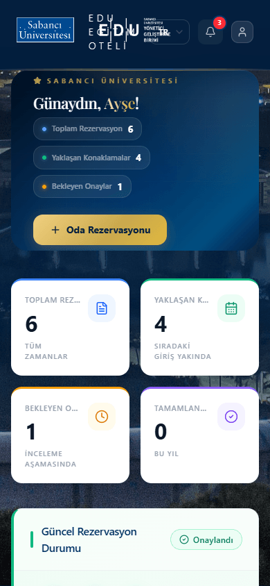

---

## 3. The life of a reservation

Most of what you do on the site is one step of the process below. A reservation is not confirmed instantly. The form you send is a request that the hotel reviews. Understanding this section first will make the rest of the guide easier.

| Step | Who | What happens | Email to you? |
|---|---|---|---|
| 1. Request | You | You create a reservation request on the site. The request is **Pending**. | Yes, "request received" |
| 2. Approve or reject | Hotel | The hotel **approves** the request by setting a price, or **rejects** it. | Yes, approval with price, or rejection |
| 3. Payment | You | You make a bank transfer and upload the receipt. | Yes, "receipt received" |
| 4. Payment check | Hotel | The hotel checks the receipt and **approves** or **rejects** it. If rejected, you upload a new receipt. | Yes, "booking confirmed" or "receipt not accepted" |
| 5. Room assignment | Hotel | The hotel assigns a room to your reservation. Guests cannot choose rooms. | Yes, with the room details |

A reservation has two separate statuses that are tracked independently:

**Reservation status**

| Status | Meaning |
|---|---|
| Pending | Your request is waiting for the hotel's approval. |
| Approved | Your request is approved. Payment and room assignment may still be in progress. Your stay is confirmed once the payment is approved. |
| Rejected | The hotel rejected your request. You can create a new one. |
| Cancelled | You canceled the reservation. |

**Payment status**

| Status | Meaning |
|---|---|
| Not shown | You have not uploaded a receipt yet. |
| Payment Pending Verification | Your receipt was uploaded and is waiting for the hotel's check. Verification is typically completed within 1 business day. |
| Payment Confirmed | The hotel approved your receipt. Your stay is confirmed. |
| Payment Rejected | The hotel did not accept your receipt. You need to upload a new one. |

You may also see **Refund Requested** and **Refunded** in the lists. Refunds cannot be started on the site. For a refund, [contact the hotel](#11-contact-support).

### Reservation rules

The system does not accept requests that break the rules below. If the hotel has lowered the night limit, you may see the warning at the last step of the form. In that case, the limit in the warning applies.

- Check-in on Sunday is not allowed.
- Saturday check-in together with Sunday check-out is not allowed.
- Personal stays can be at most 5 nights.
- Check-in can be at most 30 days ahead. For a later date, contact the hotel.
- A request can include at most 10 guests.
- A program code is required for corporate stays.
- An explanation is required for academic stays.
- An ID or passport copy must be uploaded for every guest.
- You cannot cancel a reservation yourself if check-in is less than 24 hours away or your payment has been approved.

---

## 4. Main Page

This page opens first when you sign in. At the top are a personal welcome area, summary numbers and a **Book a Room** button for creating a new request. The figure on the right opens the [Atlas Concierge](#9-atlas-concierge) assistant.

The four cards under the welcome area:

| Card | What it shows |
|---|---|
| Total Reservations | All requests you have ever created |
| Upcoming Stays | Requests with a future check-in date that are not cancelled or rejected |
| Pending Approvals | Requests waiting for the hotel's approval |
| Completed Stays | Approved reservations whose check-out date has passed |

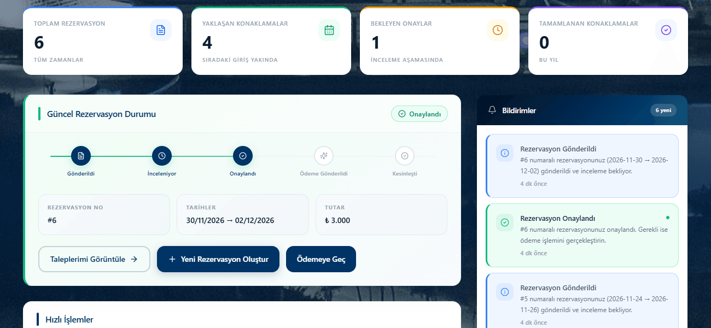

**Current Reservation Status.** Shows the reservation you created most recently. The line at the top shows the stage you are at: Submitted, Under Review, Approved, Payment Sent, Confirmed. Below it are the reservation number, dates and amount. The amount shows "To be determined" until the hotel approves the request.

The buttons in this section:

- **View My Requests:** opens the [My Reservations](#6-my-reservations) page.
- **Create New Reservation:** opens the [Book a Room](#5-book-a-room) page.
- **Proceed to Payment:** becomes active when your request is approved and its price is set, and opens the [Payment](#7-payment) page. If the request is approved but no price has been entered yet, the button says **Awaiting Price**. After you upload a receipt it says **Payment Sent**, and after the payment is approved it says **Payment Confirmed**.

**Notifications.** The section on the right shows the three latest notifications. Clicking one opens the [My Reservations](#6-my-reservations) page.

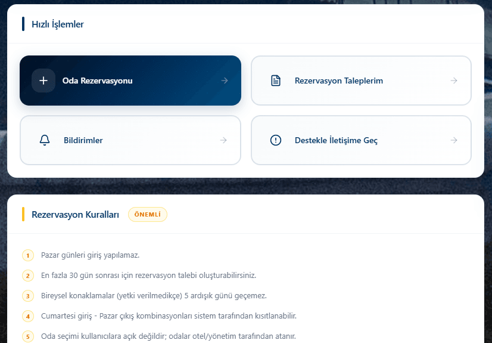

**Quick Actions.** Shortcuts to the Book a Room, My Reservation Requests, Notifications and Contact Support pages.

**Reservation Rules.** A short summary of the [reservation rules](#reservation-rules).

The button on the **Need Help?** card in the bottom right does not open a page at the moment. To reach the support page, use the **Contact Support** shortcut under **Quick Actions**.

---

## 5. Book a Room

A reservation request has three steps. The bar at the top shows the step you are on. Use **Next** to move forward and **Back** to return. If something is missing or breaks a rule, a red warning appears at the top of the card and you cannot move to the next step.

If you leave the page before sending the form, the information you entered is lost.

### 5.1 Step 1: Stay dates

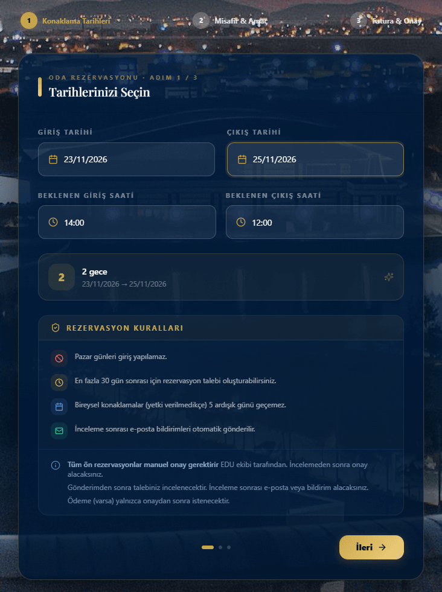

1. Click **Check-In Date** and **Check-Out Date** and choose dates from the calendar. Past days cannot be selected.
2. Check **Expected Check-In Time** and **Expected Check-Out Time**. The hotel's standard times are filled in for you. To change them, click the field, then choose the hour and minutes from the list or type the time.
3. After you choose the dates, the number of nights appears on a card. Check it and click **Next**.

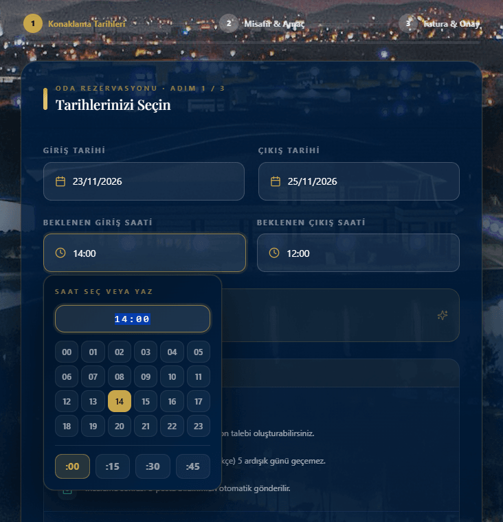

If you chose a date that breaks a rule, you see a warning when you click **Next**. In that case, change the dates.

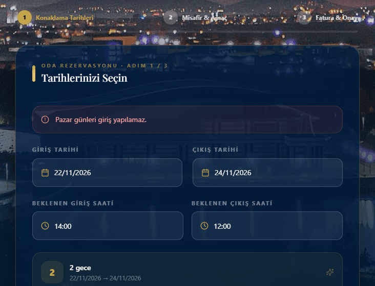

### 5.2 Step 2: Guest and purpose

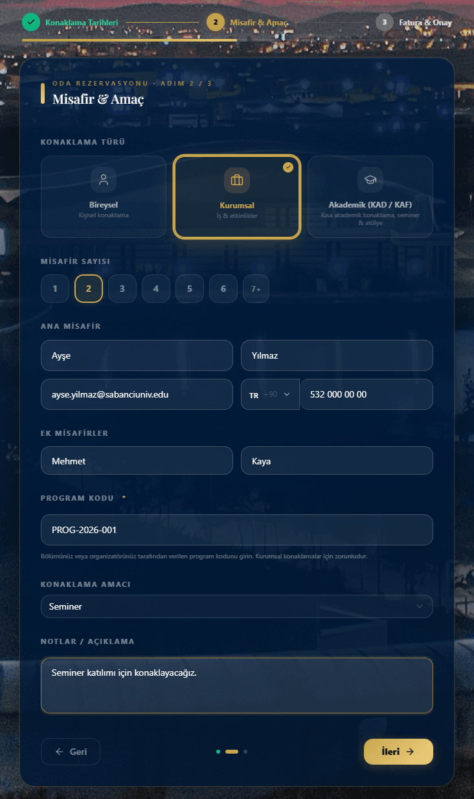

1. Choose the **Accommodation Type**:

   | Type | When to choose it | Also required |
   |---|---|---|
   | Personal | A personal stay | At most 5 nights |
   | Corporate | A stay for business or an event | **Program Code** (given by your department or organizer) |
   | Academic (KAD / KAF) | Short academic stays, seminars and workshops. Shown as "Education" in lists. | **Notes / Explanation** field |

2. Choose the **Number of Guests**. For 7 or more, click **7+** and type the number (at most 10).
3. Check the **Primary Guest** details. Your name and email come from your account. Type your **Phone** number yourself and choose the country code.
4. If there is more than one guest, type everyone's first and last name under **Additional Guests**.
5. Choose the **Purpose of Stay** from the list: Conference, Seminar, Workshop, Training, Meeting, Personal or Other.
6. Write anything you want to tell the hotel in **Notes / Explanation**. If you see a registry number (sicil) warning on the screen, write your registry number here. Parents write the student's registry number.
7. Click **Next**.

### 5.3 Step 3: Billing and confirmation

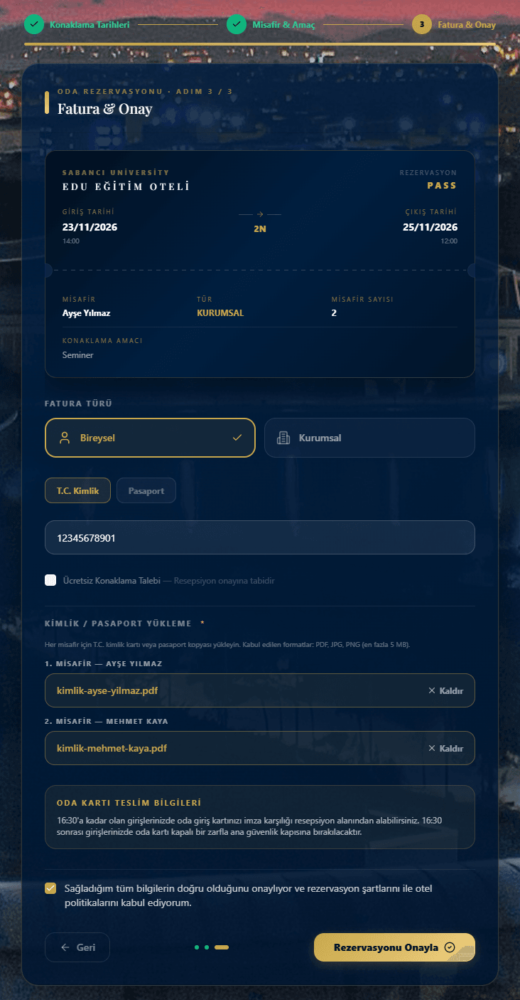

1. On the summary card at the top, check the dates, number of guests and accommodation type. If something is wrong, go **Back** and correct it.
2. Choose the **Billing Type**:
   - **Individual:** choose **T.C. Kimlik** (Turkish national ID) or **Passport** and type the number.
   - **Corporate:** fill in **Tax Number**, **Company / Institution Name** and **Billing Address**.
3. If you believe you are entitled to a free stay, tick **Request Free Accommodation**. This is subject to approval by reception and does not make your stay free by itself. Check your approval email or ask the hotel for the result.
4. Under **ID / Passport Upload**, click **Choose file...** for each guest and upload the document. PDF, JPG and PNG are accepted, and each file can be at most 5 MB. If you choose another file type, the document is not saved and no warning appears, so check the file type. You can delete a wrong file with **Remove**.
5. Read the **Key Pickup Instructions**. For details, see [Arrival and key card](#12-arrival-and-key-card).
6. Tick the consent box and click **Confirm Reservation**.

### 5.4 After sending the request

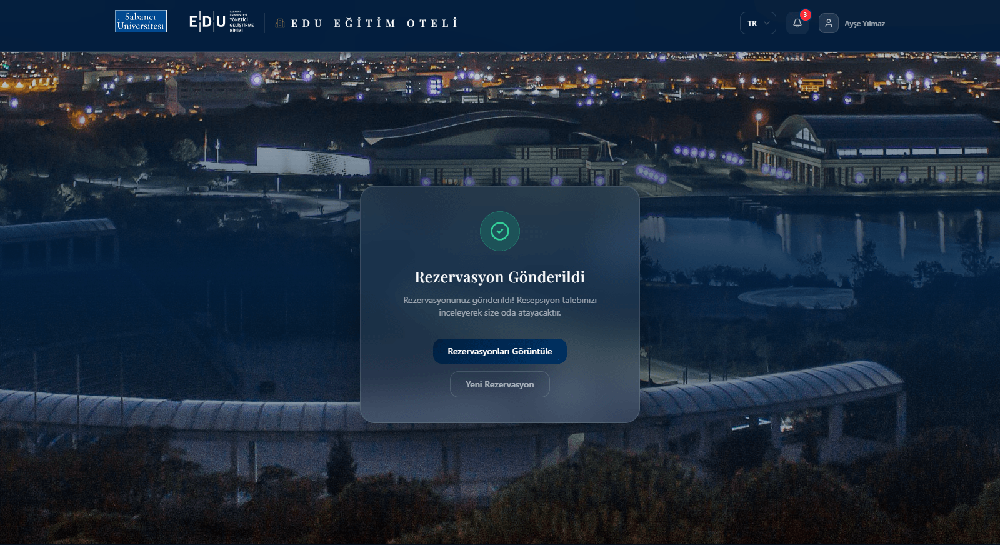

The "Reservation Submitted" screen shows that your request was received, and you receive a "request received" email. Despite the name of the **Confirm Reservation** button, your stay is not confirmed at this point. The hotel reviews your request and sends you the result by email. You can also follow the status on the [My Reservations](#6-my-reservations) page.

---

## 6. My Reservations

Lists all your requests, newest first. Going to payment and canceling are done from this page.

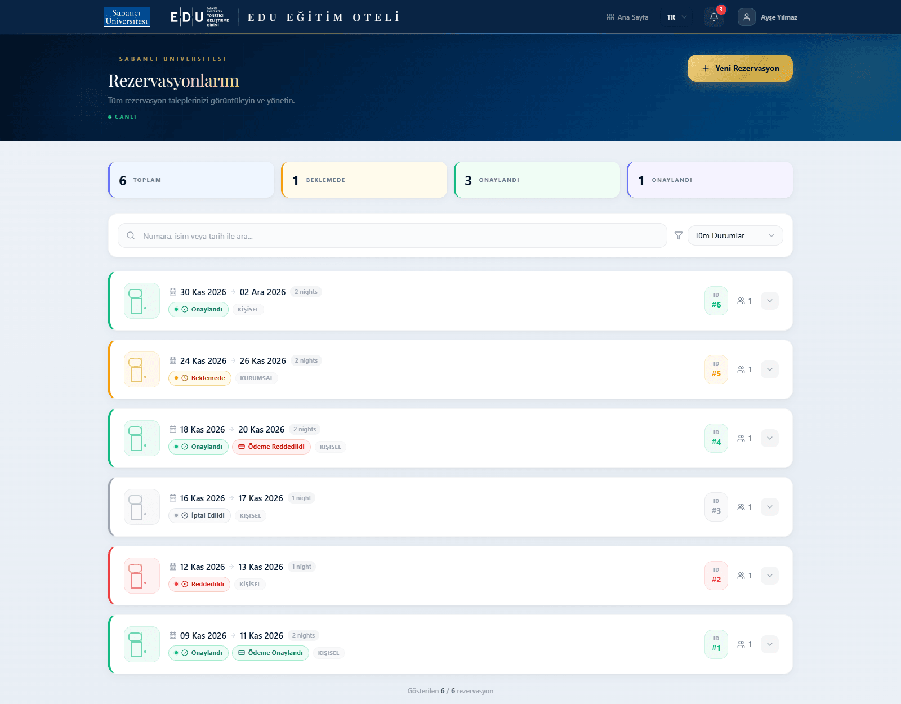

The four cards at the top show the number of total, pending, approved and confirmed (payment approved) reservations.

Each row shows the dates, number of nights, reservation status, payment status if there is one, accommodation type, reservation number and number of guests. While the page is open, the list updates by itself every 30 seconds. If your request is approved, a message also appears on the screen.

### 6.1 Searching and filtering

- Type a reservation number, guest name or date into the search box.
- Use the list on the right to filter by status: **All Statuses**, **Pending**, **Approved**, **Rejected**, **Cancelled**, **Refund Requested**, **Refunded**.

### 6.2 Reservation details

Click a row. The section that opens shows guest information, stay details, and billing details with notes. Click again to close it.

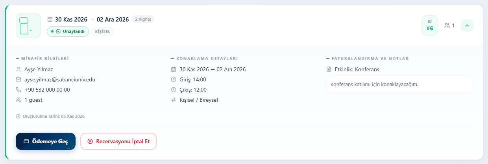

After a room is assigned, your room number appears under **Stay Details**. If more than one room is assigned, all rooms are listed in the room assignment email.

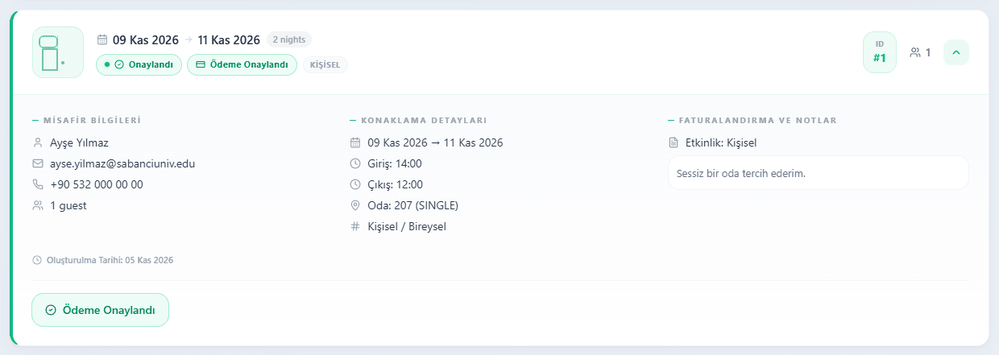

The details of a rejected request show the **Rejection Reason** written by the hotel.

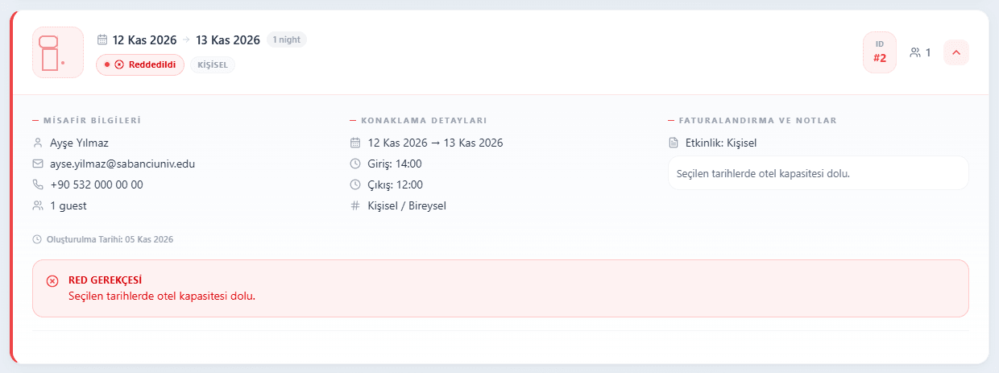

At the bottom of the details you see the following, depending on the status:

| Status | What you see |
|---|---|
| Pending | **Cancel Reservation** |
| Approved, no receipt uploaded | **Proceed to Payment**, **Cancel Reservation** |
| Receipt being verified | **Awaiting Payment Verification** label, **Cancel Reservation** |
| Payment rejected | **Proceed to Payment**, **Cancel Reservation** |
| Payment approved | **Payment Confirmed** label |

### 6.3 Canceling a reservation

1. Open the reservation's details and click **Cancel Reservation**.
2. Type a reason in the box that opens. The reason is optional.
3. Click **OK**. Click **Cancel** to go back without canceling. The button names may vary by browser.

The reservation becomes **Cancelled** and you receive an email. Canceling cannot be undone. If you change your mind, you need to create a new request.

Things to keep in mind:

- If check-in is less than 24 hours away, the button is still shown, but the reservation is not canceled and you see "Cancellations must be made at least 24 hours before check-in." The time is counted from the start of the check-in day (03:00 Turkey time), not from the check-in time you chose, so do not leave it to the last day.
- If you cancel after uploading a receipt, your payment is not refunded automatically. Contact the hotel for a refund.
- A reservation with an approved payment cannot be canceled on the site. In this case, and when less than 24 hours are left, [contact the hotel](#11-contact-support).

---

## 7. Payment

Payment is made by bank transfer. After your request is approved and its price is set, you make the transfer and upload the receipt on this page.

Open the page with the **Proceed to Payment** button on the **Main Page** or in the reservation details.

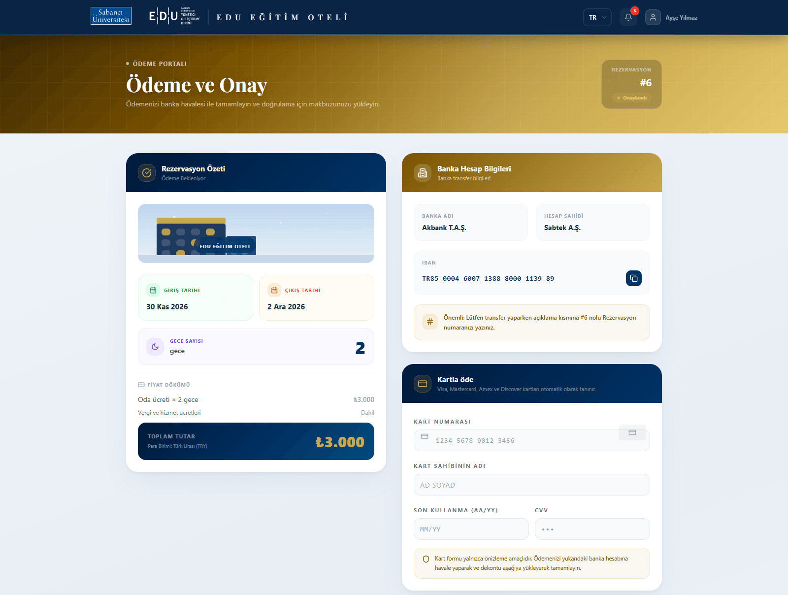

**Important: check that you are on the right reservation.** The payment page always opens the reservation you created **most recently**, no matter which reservation you came from. Check the number in the **Reservation** box in the top right. If it is not the number of the reservation you want to pay for, do not upload a receipt, and [contact the hotel](#11-contact-support). To avoid this problem, try not to create a new request while a payment is outstanding.

### 7.1 Making the transfer

1. In the **Reservation Summary**, check the dates and the **Total Amount**. The total amount is the fee the hotel set for this stay.
2. Make the transfer from your bank using the bank name, account holder and IBAN under **Bank Transfer Information**. You can copy the IBAN with the button next to it.
3. Write your reservation number in the transfer description. The number is shown in the yellow notice box.
4. After the transfer, save the receipt your bank gives you.

### 7.2 Uploading the receipt

1. Under **Upload Payment Receipt**, click the box and choose the file, or drag the file onto the box. PDF, JPG and PNG are accepted, and the file can be at most 5 MB.
2. Check that the file name and "File ready to upload" appear. You can remove a wrong file with the red cross.
3. Click **Submit Receipt for Review**.

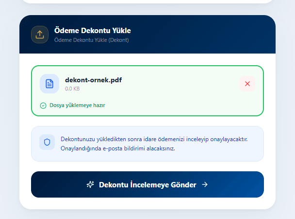

After you confirm the "Payment receipt submitted successfully!" message, the Main Page opens. Your payment becomes **Payment Pending Verification** and you receive an email. The hotel checks the receipt and sends you the result by email.

If you see a **Price not set yet** warning, the submit button does not work. Wait for the hotel to approve your request and set the price. If it takes long, contact the hotel.

### 7.3 If your receipt is rejected

If the hotel does not accept the receipt, you receive an email with the reason and the reservation shows **Payment Rejected**. Make sure the amount is correct and the receipt is readable. Then open the page again with **Proceed to Payment** and upload a new receipt. Do the reservation number check above in this case too.

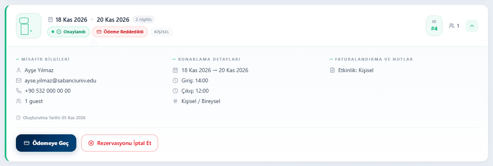

### 7.4 The card payment form

The **Pay with card** form on this page is for preview only. No payment is taken through it. Do not enter your card details here. Pay by bank transfer.

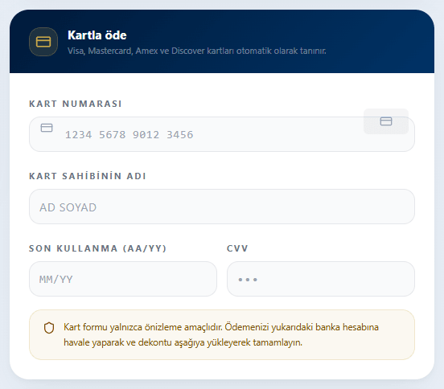

---

## 8. Notifications

Notifications show changes to your reservations on the site. They are separate from emails, and you can check both.

### 8.1 The notification bell

Click the bell in the top bar. The last 8 notifications open. The red number on the bell shows how many of these 8 are unread.

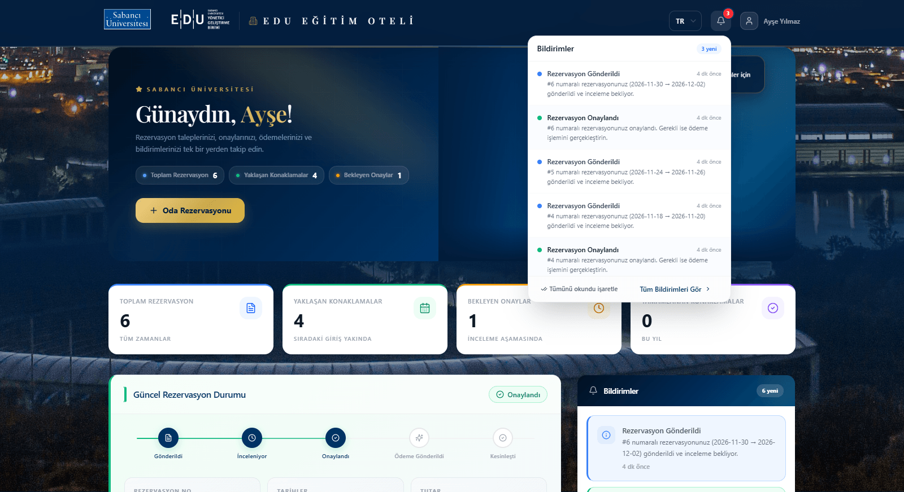

If you click a notification, it counts as read and [My Reservations](#6-my-reservations) opens. **Mark all as read** marks them all as read. **View All Notifications** opens the notifications page.

### 8.2 The notifications page

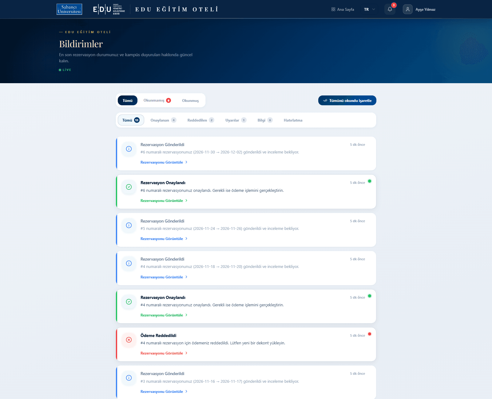

- Use the upper buttons to filter by read status: **All**, **Unread**, **Read**.
- Use the lower buttons to filter by type: **All**, **Approved**, **Rejected**, **Warnings**, **Info**, **Reminders**.
- **View Reservation** opens the related page.

The read status is kept in the browser you use. If you sign in from another device, the same notifications may appear as unread.

The notifications you may see:

| Notification | When |
|---|---|
| Reservation Submitted | You create a request |
| Reservation Approved | The hotel approves your request |
| Reservation Rejected | The hotel rejects your request |
| Reservation Cancelled | You cancel your reservation |
| Payment Receipt Uploaded | You uploaded a receipt and it is awaiting verification |
| Payment Confirmed | The hotel approves your payment |
| Payment Rejected | The hotel does not accept your receipt |
| Check-in Reminder | Check-in of your approved reservation is less than 48 hours away |

---

## 9. Atlas Concierge

Atlas is the hotel attendant figure on the Main Page. It answers common questions and lets you send requests to reception. Click the figure or the speech bubble next to it to open it. Click the cross on the panel to close it. Atlas is shown on tablets and computers, not on phones.

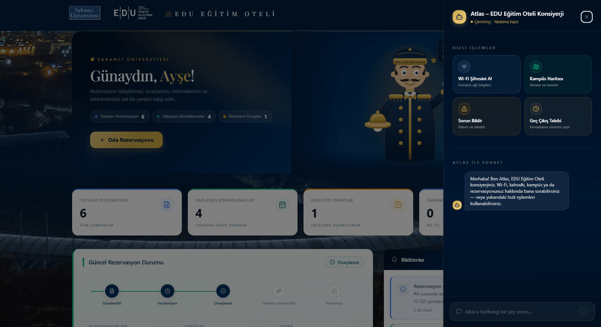

The **Quick Actions** at the top of the panel:

| Button | What it does |
|---|---|
| Get Wi-Fi Password | Shows the hotel's Wi-Fi network name and password. You can copy them with **Copy**. |
| View Campus Map | Opens the Tuzla campus map. Click the map to zoom and click outside to close it. The Esc key closes the Atlas panel along with the map. |
| Report an Issue | Sends a problem about your room or the facilities to reception. |
| Request Late Check-out | Sends your late check-out request to reception. |

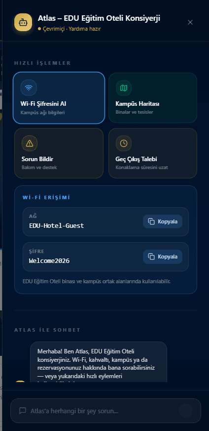

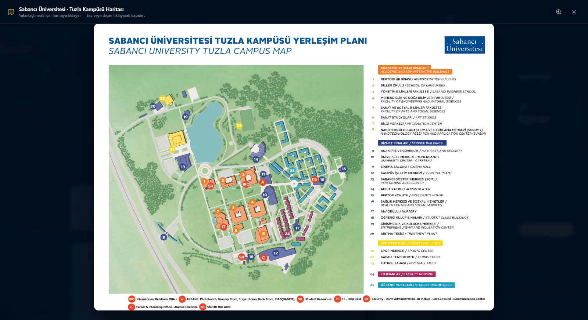

### 9.1 Reporting an issue or requesting late check-out

1. Click **Report an Issue** or **Request Late Check-out**.
2. For an issue, write a short title and a description, and mention your room number. For late check-out, write your reservation number, the time you want and the reason. The description is required.
3. Click **Send to reception**.

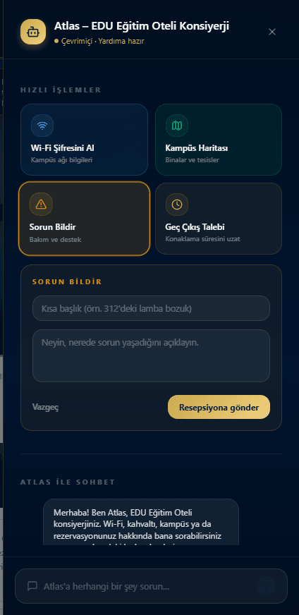

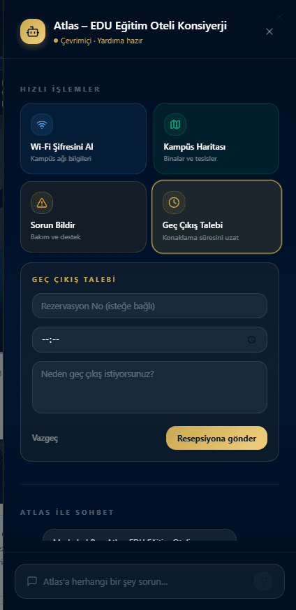

Your request is sent to reception by email with your name and your account's email address. The room and reservation numbers are not added automatically, so include them in your message. Late check-out depends on availability. Sending a request does not mean it is approved.

### 9.2 Chatting with Atlas

Type your question in the box at the bottom of the panel. Atlas is not a real person. It gives ready-made answers on topics such as breakfast, the campus, transport and cancellation.

**What you write in the chat is not sent to reception.** Even if Atlas replies that it will pass your message to the reception team, your message does not reach anyone. To reach reception, use the **Report an Issue** or **Request Late Check-out** forms or the [Contact Support](#11-contact-support) channels. For Wi-Fi details, too, use the **Get Wi-Fi Password** button rather than the chat answer.

---

## 10. Profile

Opens when you click your name in the top bar. You can see your account details and log out.

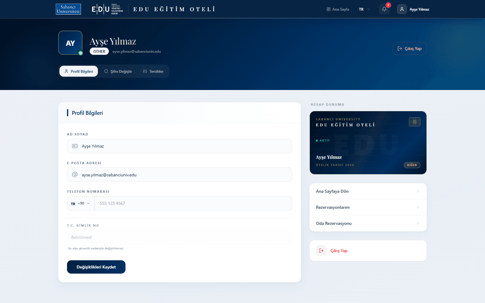

The page has three tabs:

- **Profile Information:** your name, email, phone and national ID number.
- **Change Password:** the password rules and password fields.
- **Preferences:** shows that email notifications are on and SMS notifications are off. These settings cannot be changed here.

On the right are your membership card, the **Back to Dashboard**, **My Reservations** and **Book a Room** shortcuts, and the **Logout** button.

**Important:** the **Save Changes** and **Update Password** buttons do not save your changes at the moment. Your details do not change, even though no error appears on the screen.

- **To change your password,** log out and follow the steps under [If you forgot your password](#if-you-forgot-your-password).
- **To change your name, email or phone,** [contact the hotel](#11-contact-support). You can also enter the name, email and phone to use for a reservation on the request form.

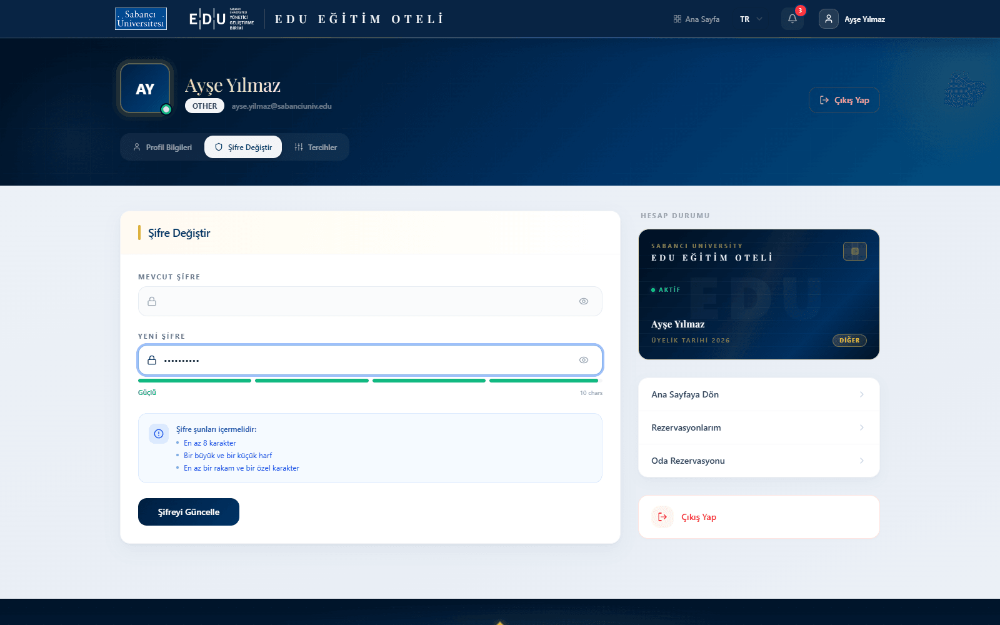

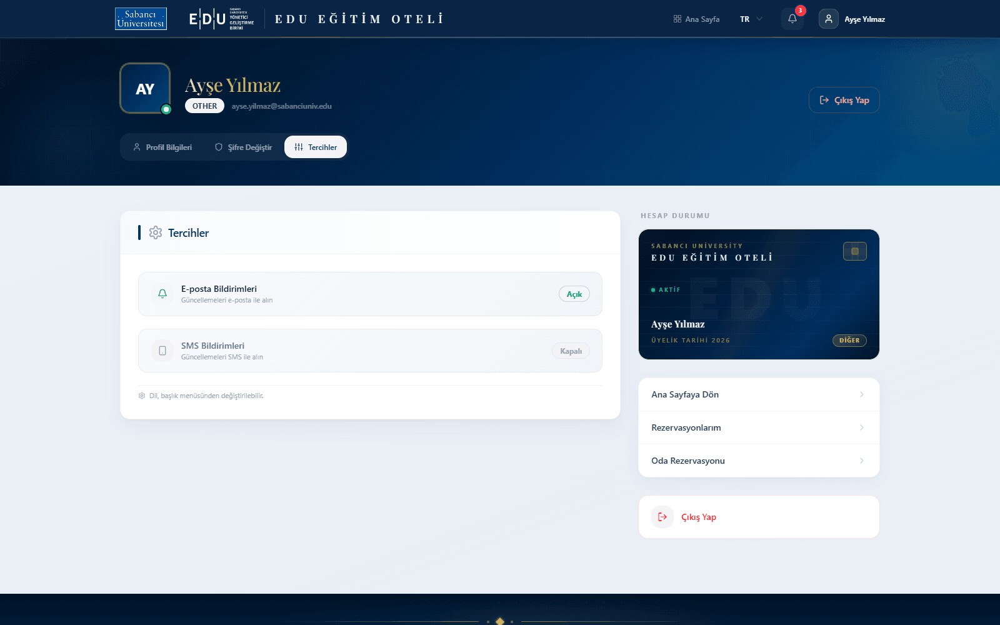

---

## 11. Contact Support

Shows the hotel's contact channels. Open it with the **Contact Support** shortcut under **Quick Actions** or the link at the bottom of the page.

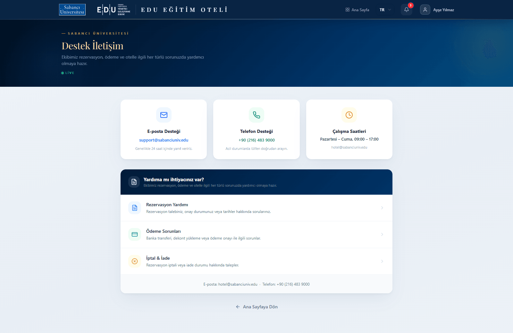

| Channel | Details | Note |
|---|---|---|
| Email support | support@sabanciuniv.edu | Usually answered within 24 hours. |
| Hotel email | hotel@sabanciuniv.edu | This address also appears in emails from the hotel. |
| Phone | +90 (216) 483 9000 | For urgent matters, call directly. |
| Office hours | Monday – Friday, 09:00 – 17:00 | |

The **Reservation Help**, **Payment Issues** and **Cancellation & Refunds** headings show what you can get help with. Clicking them does not open a page. For a quick answer, include your reservation number in your message.

---

## 12. Arrival and key card

Your stay is confirmed when the hotel approves your payment. You can find your room number in the room assignment email and on the [My Reservations](#6-my-reservations) page. If no room has been assigned yet, the "Booking confirmed" email says the room will be communicated at check-in.

Where you collect your key card depends on your check-in time:

| Check-in time | Where to collect the key card |
|---|---|
| Before 16:30 | At reception, against signature |
| After 16:30 | At the main security gate, in a sealed envelope |

Bring a valid ID with you at check-in.

The standard check-in and check-out times are filled in on the reservation form (check-in 14:00, check-out 12:00). The hotel can change these times. For late check-out, send a request through [Atlas Concierge](#91-reporting-an-issue-or-requesting-late-check-out).

---

## 13. Frequently asked questions

**I get an "@sabanciuniv.edu" warning when signing up.**
You can only sign up with an address ending in this domain. If you do not have one, [contact the hotel](#11-contact-support). If the hotel enters a reservation for you, you can set a password with the email address you gave them by following the steps under [If you forgot your password](#if-you-forgot-your-password), and then sign in.

**My password is not accepted.**
Even though the screen says "Min. 8 characters", the password must also include at least one uppercase letter, one lowercase letter, one number and one special character.

**I get a message that my account is blacklisted.**
In this case you cannot sign in or create requests. [Contact the hotel](#11-contact-support) for information.

**My reservations look empty.**
Your 1-hour session has most likely ended. Your reservations have not been deleted. Log out from the [Profile](#10-profile) page and sign in again.

**Can I choose a room?**
No. The hotel assigns rooms. You can write your preference in the **Notes / Explanation** field of the request form.

**I need a Sunday check-in but the form does not allow it.**
The system does not accept Sunday check-in or a Saturday check-in with a Sunday check-out. If you have a special situation, contact the hotel.

**I want to book more than 30 days ahead or stay longer than 5 nights.**
The system enforces these limits. [Contact the hotel](#11-contact-support). The 5-night limit applies only to personal stays.

**The "Proceed to Payment" button is faded or does not respond.**
Your request may not be approved yet, its price may not be set, or your receipt may already be uploaded. The button on the Main Page applies only to the reservation you created most recently. For earlier reservations, see the [My Reservations](#6-my-reservations) page.

**The payment page shows a different reservation.**
The payment page always opens the reservation you created most recently. Do not upload a receipt, and [contact the hotel](#11-contact-support).

**I uploaded the wrong receipt.**
After a receipt is submitted, the **Proceed to Payment** button is no longer available. Tell the hotel, with your reservation number. If the hotel rejects the receipt, you can upload a new one.

**My file is not accepted when uploading a receipt.**
The file must be PDF, JPG or PNG and must not exceed 5 MB.

**I cannot cancel my reservation.**
Check-in may be less than 24 hours away or your payment may be approved. In these cases, [contact the hotel](#11-contact-support). Refund requests are also handled through the hotel.

**I changed my details on the Profile page but they went back.**
The save buttons on the Profile page do not work at the moment. See [Profile](#10-profile).

**I wrote to Atlas but nobody replied.**
Chat messages are not sent to reception. Use the **Report an Issue** or **Request Late Check-out** form, or contact the hotel directly.

**I am not receiving emails.**
Check your spam folder. You can always see the status of your request on the [My Reservations](#6-my-reservations) and [Notifications](#8-notifications) pages.

---

## 14. Appendix: Automatic emails you receive

The system sends the emails below automatically, in Turkish or English depending on the language you chose on the site.

| When | Subject |
|---|---|
| You create a request | EDU Hotel – Reservation request received |
| The hotel approves your request | EDU Hotel – Reservation approved |
| The hotel rejects your request | EDU Hotel – Reservation not approved |
| You upload a receipt | EDU Hotel – Payment receipt received |
| The hotel approves your payment | EDU Hotel – Booking confirmed |
| The hotel does not accept your receipt | EDU Hotel – Payment receipt not accepted |
| The hotel assigns a room | EDU Hotel – Room assigned |
| You cancel your reservation | EDU Hotel – Reservation cancelled |
| You request a password reset | EDU Hotel – Reset your password |

Except for the password reset email, each subject ends with the reservation number. The "Booking confirmed" subject also has a ✓ mark. If more than one room is assigned, the subject says "Rooms assigned". The hotel can temporarily turn off all emails except password reset. If an email you expect does not arrive, check the status on the site's pages.
